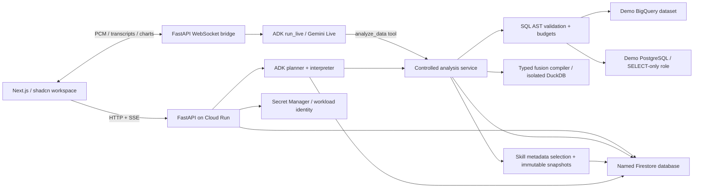

# Architecture

The frontend contains no database credentials or Google model keys. `/api/config` supplies only the public backend URL at runtime. Direct browser requests use explicit CORS origins; the WebSocket validates Origin and its first authentication frame. Guest tokens identify requests and cancellation ownership without providing account privacy.

## Analysis lifecycle

The operator selects a `legacy` or `timeseries` data profile. The latter uses versioned `sales_*` facts, a daily calendar, and `retail_timeseries` dimensions while preserving the original demo tables. A deterministic streaming Parquet generator and operator-only fenced uploader perform independent reconciliation and insert-only publication. Query execution checks the import-ready state and uses profile-specific table/schema allowlists. The time-series release allows 30,000 source rows for its 25,000-customer dimension while keeping byte, scan, fusion, preview, and read-only controls. See [the data workflow](retail-timeseries.md).

The browser chooses a pinned analysis model from `GET /api/v1/models`. The backend allowlist permits Gemini 3.8 Flash and Gemini 3.5 Flash-Lite, with an optional workspace-default choice. Turn creation snapshots the resolved identifier transactionally with the run; idempotency checks include the requested choice. Task-local model context carries that snapshot through skill selection, planning, repairs, and interpretation without changing shared settings. Analyst voice sessions capture the same preference at authentication for their data tools; live speech/skill authoring and embeddings retain their separately configured models. Artifacts record Gemini model evidence or explicitly identify fixture execution.

1. Atomically charge guest/workspace quotas, reserve an idempotent run ID, and acquire the conversation's fenced lease.
2. Retrieve versioned schema context; use Gemini embeddings/vector search when available, retaining complete context for the small seeded schema.
   Before schema planning, resolve shared manual skill attachments, select relevant additional skills from metadata in one bounded call, and persist exact revisions. At most three skills apply. Planner repairs and interpretation reuse these snapshots in analysis-scoped ADK sessions. Public playbooks cannot change application safeguards.
3. Ask an ADK structured planner for a typed analysis plan. Tool-free planning uses one model call; at most two SQL repairs are permitted.
4. Validate all SQL, then execute with restricted data access, time/scan/row/byte limits, and persisted job IDs.
5. For two sources, register bounded, complete Arrow results in a fresh DuckDB child process. Compile an allowlisted typed fusion plan. Check key types, null semantics, cardinality, coverage, and output limits. No arbitrary model-generated Python or fusion SQL is executed.
6. Persist immutable paginated results and source evidence; ask the interpreter for an explanation grounded in the result. Stream named progress and public answer events.
7. Release the lease only if its run ID and fencing generation still match.

LLM generation uses LOW thinking, bounded output, 45-second HTTP deadlines, a 55-second structured-call deadline, and a 180-second analysis deadline. Live sessions are limited to three minutes. These are execution controls, not a guaranteed monetary spending cap.

## Persistence

Firestore collections: `conversations` with `messages`; `runs` with `events` and `queries`; `artifacts` with `pages`; `adk_sessions` with `events`; `schema_chunks`; `quotas`; and private `voice_resumptions`.

The [skills library](skills.md) adds `skills/{id}/revisions`, `runs/{id}/skill_snapshots`, and `system/skills_capacity`. Library mutations are transactional with optimistic revision checks and edit quotas. Only the backend accesses Firestore. Active discovery uses metadata projections; only selected instruction bodies enter model context. History reset preserves the library. Answers link to immutable revisions, including after soft deletion. Every voice data-tool invocation gets its own analysis ID and snapshot.

Large results are stored in pages below 180 KiB. ADK events are separate documents, preserving ordered events and session state without persisting temporary state or raw audio. All writes during a run validate the current conversation lease. Transaction callbacks do not invoke models or databases.

Only one active analysis or live voice session owns a conversation. Another visitor can wait or fork. Completed history is public. A disconnected text browser can reconnect to persisted SSE events without starting another query. A stopped worker is reported as interrupted after its lease expires; a new request is required rather than silently rerunning jobs.

## Voice

An AudioWorklet produces 16 kHz signed PCM samples; the browser queues 24 kHz PCM playback. Audio streams through FastAPI to ADK `Runner.run_live()`. The `analyze_data` tool calls the same bounded analysis service as text. Audio is streamed rather than recorded. Durable transcripts and public result references are distinct from the private, short-lived Live resumption handle.

## Explicit limits

- Only BigQuery and PostgreSQL connectors are implemented. Local fixtures are a labeled development mode.
- Hosted PostgreSQL uses Cloud SQL. A local DSN is supported for development; private on-premises networking is a documented extension.
- Inference does not prove semantic equivalence. Key profiling can expose incompatible relationships but cannot establish business meaning by itself.
- Independent source queries do not share a transaction snapshot.
- DuckDB processes are bounded and terminated on deadline; no untrusted SQL is admitted to that engine. Its memory setting does not independently cap every Arrow/Python allocation.
- Source queries must produce complete bounded fusion inputs. Oversized results require narrower filters or source-side aggregation.

## Conversational skill author

The [voice author](voice-skill-author-plan.md) has its own guest-scoped session and no analysis/query tool. It uses the same browser PCM transport and pinned Gemini Live model with two tools: record typed requirements and prepare a deterministic Markdown draft. The visitor reviews/edits and publishes through an HTTP action. Publication atomically checks the author revision/lease, normal skill quotas/capacity, and first immutable skill revision. Retries return the same skill rather than inserting another.

`skill_author_sessions` stores a bounded brief, transcript, draft, expiry, and fenced connection generation. The ADK adapter accepts an explicit lease collection while retaining `conversations` as its default. Reconnect starts a fresh ADK generation with saved context; the SDK can resume model transport inside that generation. A stale process cannot write into another generation. Raw audio is neither stored in author documents nor persisted through ADK (`save_live_blob=False`).

Partial transcript events append; final full transcripts replace the partial buffer. Interrupted and tool-only completion events do not finish an audible reply. The browser releases audio devices while waiting for the server's final saved-state acknowledgement. A second close event cannot reload over a visitor's unsaved review edits. These behaviors have deterministic regressions and a real-model smoke.

Author sessions logically expire after six hours. An operator cleanup command removes only expired/inactive sessions and their ADK generations; publication evidence lives in the normal immutable skill revisions and is preserved. No new cloud resources, IAM grants, or browser Firestore access are required.
