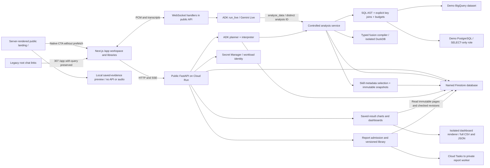
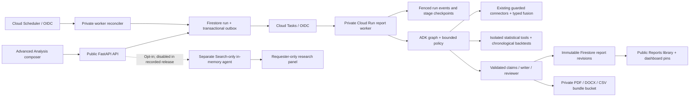

# Architecture

This describes the implemented application. [deployment.json](deployment.json) and [validation.md](validation.md) record the last verified release on **17 October 2026**; they are dated evidence rather than live service discovery. The public frontend/API and private report worker are deployed. The recorded profile is `timeseries`, and optional Search research is disabled.

Standalone Mermaid copies live in [graphify/](graphify/README.md). Refresh them from the fenced blocks below when changing a flow.

## Application boundaries

The [landing/workspace route split](landing-page.md) was introduced in frontend `00012-mv5`. The subsequent [analytics/voice fix release](evaluation/e2e-fixes-deployed.md), verified on 17 October 2026, serves frontend `00013-hrz`, backend `00018-ctv` and private worker `00007-pfq`. The landing page has no analytics or voice client and makes no backend requests. `/app` owns conversation history and shared links. Existing library/detail routes are unchanged.

The frontend contains no database credentials or Google model keys. `/api/config` supplies only the public backend URL at runtime. Direct browser requests use explicit CORS origins; the WebSocket validates Origin and its first authentication frame. Guest tokens identify requests and cancellation ownership without providing account privacy.

The voice bridge and skill author are handlers within the public backend, not additional deployed services. Browser pages use the API for every persistent read/write. The separate report worker accepts authenticated task/scheduler invocation; its internal endpoints are not mounted on the public API. Database/model credentials stay in workload identity and backend secret references.

## Source-code map

| Capability | Main implementation | Contract / guide |
| --- | --- | --- |
| Public landing and guided preview | `Frontend/src/app/page.tsx`, `Frontend/src/components/landing/`, `Frontend/src/lib/landing-preview-data.json` | [Landing page](landing-page.md), [ADR 0008](adr/0008-landing-workspace-routes.md) |
| Workspace route compatibility | `Frontend/src/app/app/page.tsx`, `Frontend/next.config.ts`, `Frontend/src/lib/workspace-links.ts` | [Landing page](landing-page.md) |
| Workspace and runtime API configuration | `Frontend/src/components/workspace.tsx`, `Frontend/src/lib/api.ts`, `Frontend/src/app/api/config/route.ts` | [Setup](setup.md), [settings](settings.md) |
| Public routing and ordinary analysis | `Backend/app/main.py`, `analysis.py`, `ai.py`, `repository.py` | `Backend/app/models.py`, [ADRs](adr/) |
| SQL and cross-source fusion | `Backend/app/connectors.py`, `sql_guard.py`, `fusion.py` | [Retail schema](retail-timeseries-schema.md), [ADR 0003](adr/0003-bounded-cross-source-fusion.md) |
| Saved-result chart preparation | `Backend/app/chart_presentation.py`, `Frontend/src/components/charts/insightful-chart.tsx` | [Charts](charts.md) |
| Shared dashboards and downloads | `Backend/app/dashboards.py`, `dashboard_exports.py`, `Frontend/src/components/dashboard-workspace.tsx`, `dashboard-actions.tsx` | `Backend/app/dashboard_models.py`, [dashboards](dashboards.md) |
| Skills and author interviews | `Backend/app/skills.py`, `skill_author.py`, `skill_author_voice.py`, `Frontend/src/components/skills-workspace.tsx`, `skill-voice-author.tsx` | [Skills](skills.md), [voice author](voice-skill-author-plan.md) |
| Analytics/prediction playbooks | `Backend/app/skill_library/`, `skill_examples.py` | [Playbook catalog](analytics-skills.md) |
| Report orchestration and recovery | `Backend/app/report_harness.py`, `report_engine.py`, `report_repository.py`, `report_dispatch.py`, `report_worker.py` | `Backend/app/report_models.py`, [reports](reports.md) |
| Statistics, files and isolated research | `Backend/app/report_statistics.py`, `report_exports.py`, `report_research.py` | [Reports](reports.md), [ADR 0007](adr/0007-public-report-evidence.md) |
| Report library/reader | `Frontend/src/components/reports-library.tsx`, `report-workspace.tsx`, `report-run-card.tsx` | `Frontend/src/lib/report-types.ts` |
| Persistence, maintenance and data publication | `Backend/app/storage.py`, `adk_sessions.py`, `maintenance.py`, `retail_generator.py`, `retail_upload.py` | [Data workflow](retail-timeseries.md), [deployment runbook](deployment-guide.md) |

Paths shortened after the first entry in a cell use that entry's directory. Source files define behavior; feature guides explain its invariants. The graph references provide navigation, not an exhaustive dependency graph.

## Analysis lifecycle

The operator selects a `legacy` or `timeseries` data profile. The latter uses versioned `sales_*` facts, a daily calendar, and `retail_timeseries` dimensions while preserving the original demo tables. A deterministic streaming Parquet generator and operator-only fenced uploader perform independent reconciliation and insert-only publication. Query execution checks the import-ready state and uses profile-specific table/schema allowlists. The time-series release allows 30,000 source rows for its 25,000-customer dimension while keeping byte, scan, fusion, preview, and read-only controls. See [the data workflow](retail-timeseries.md).

The browser chooses a pinned analysis model from `GET /api/v1/models`. The backend allowlist permits Gemini 3.8 Flash and Gemini 3.5 Flash-Lite, with an optional workspace-default choice. Turn creation snapshots the resolved identifier transactionally with the run; idempotency checks include the requested choice. Task-local model context carries that snapshot through skill selection, planning, repairs, and interpretation without changing shared settings. Analyst voice sessions capture the same preference at authentication for their data tools; live speech/skill authoring and embeddings retain their separately configured models. Artifacts record Gemini model evidence or explicitly identify fixture execution.

1. Atomically charge guest/workspace quotas, reserve an idempotent run ID, and acquire the conversation's fenced lease.
2. Retrieve versioned schema context; use Gemini embeddings/vector search when available, retaining complete context for the small seeded schema.
   Before schema planning, resolve shared manual skill attachments, select relevant additional skills from metadata in one bounded call, and persist exact revisions. At most three skills apply. Planner repairs and interpretation reuse these snapshots in analysis-scoped ADK sessions. Public playbooks cannot change application safeguards.
3. Ask an ADK planner for a typed analysis plan. The nested fusion/chart contract exceeds Vertex's structured-output complexity limit, so planning and SQL repair use JSON response mode with the full schema in the instruction, followed by strict local Pydantic validation before execution. Smaller selection/answer contracts retain native structured output. Tool-free planning uses one model call; at most two SQL repairs are permitted.
4. Validate every SELECT, including CTEs/subqueries: each new joined relation must connect to prior relations through qualified equality keys, or supported `USING` keys. Reject Cartesian/comma/NATURAL joins, constant or self-only predicates, and OR branches without a proved link. Non-equality-only joins are outside the supported contract. Validation failures enter the same bounded SQL-repair path. Execute with restricted data access, time/scan/row/byte limits, and persisted job IDs. This conservative syntax gate does not prove business grain or rule out all keyed fan-out; relationship/cardinality checks and independent numerical reconciliation still matter.
5. For two sources, register bounded, complete Arrow results in a fresh DuckDB child process. Compile an allowlisted typed fusion plan. Check key types, null semantics, cardinality, coverage, and output limits. No arbitrary model-generated Python or fusion SQL is executed.
6. Use the analytical invocation's captured `analysis_id` in `runs/{run_id}/queries/{analysis_id}_{index}_{attempt}` and BigQuery job legs. This isolates evidence for each text or voice tool call while keeping deterministic identities within an invocation and cancellation under its parent run. Persist immutable paginated results and source evidence; ask the interpreter for an explanation grounded in the result. Stream named progress and public answer events.
7. Release the lease only if its run ID and fencing generation still match.

LLM generation uses LOW thinking, bounded output, 45-second HTTP deadlines, a 55-second structured-call deadline, and a 180-second analysis deadline. Live sessions are limited to three minutes. These are execution controls, not a guaranteed monetary spending cap.

## Persistence

Firestore collections: `conversations` with `messages`; `runs` with `events` and `queries`; `artifacts` with `pages`; `adk_sessions` with `events`; `schema_chunks`; `quotas`; and private `voice_resumptions`.

The [skills library](skills.md) adds `skills/{id}/revisions`, `runs/{id}/skill_snapshots`, and `system/skills_capacity`. Library mutations are transactional with optimistic revision checks and edit quotas. Only the backend accesses Firestore. Active discovery uses metadata projections; only selected instruction bodies enter model context. History reset preserves the library. Answers link to immutable revisions, including after soft deletion. Every voice data-tool invocation gets its own analysis ID and snapshot.

Large results are stored in pages below 180 KiB. ADK events are separate documents, preserving ordered events and session state without persisting temporary state or raw audio. All writes during a run validate the current conversation lease. Transaction callbacks do not invoke models or databases.

Only one active analysis or live voice session owns a conversation. Another visitor can wait or fork. Completed history is public. A disconnected text browser can reconnect to persisted SSE events without starting another query. A stopped worker is reported as interrupted after its lease expires; a new request is required rather than silently rerunning jobs.

This ordinary-chat recovery rule differs from durable reports: reports have independent leases and committed checkpoints, and task redelivery can resume their remaining work. Skills, report revisions and retained dashboard/report artifacts survive a shared-history reset. Guest-private author recovery and requester-only research are exceptions to shared content; anonymous credentials are not verified identities.

## Voice

An AudioWorklet produces 16 kHz signed PCM samples; the browser queues 24 kHz PCM playback. Audio streams through FastAPI to ADK `Runner.run_live()`. The `analyze_data` tool calls the same bounded analysis service as text. Audio is streamed rather than recorded. Durable transcripts and public result references are distinct from the private, short-lived Live resumption handle.

Every analytical invocation uses its captured `analysis_id` in query-record keys and BigQuery job legs, so several tools in one voice run cannot overwrite each other's evidence or collide on a job ID. Repair legs remain deterministic within that invocation. All jobs remain registered under the parent run for cancellation; BigQuery recovery still rejects different SQL. Ordinary text replay does not re-enter execution. ADK partial transcripts append; finalized full text replaces the buffer and is marked as replacement for the browser. A user transcript flushed before a tool is not saved again if the same final text arrives before turn completion. Buffers reset between turns so intentional repeated questions remain valid.

## Explicit limits

- Only BigQuery and PostgreSQL connectors are implemented. Local fixtures are a labeled development mode.
- Hosted PostgreSQL uses Cloud SQL. A local DSN is supported for development; private on-premises networking is a documented extension.
- Inference does not prove semantic equivalence. Key profiling can expose incompatible relationships but cannot establish business meaning by itself.
- Independent source queries do not share a transaction snapshot.
- DuckDB processes are bounded and terminated on deadline; no untrusted SQL is admitted to that engine. Its memory setting does not independently cap every Arrow/Python allocation.
- Source queries must produce complete bounded fusion inputs. Oversized results require narrower filters or source-side aggregation.

## Conversational skill author

The [voice author](voice-skill-author-plan.md) has its own guest-scoped session and no analysis/query tool. It uses the same browser PCM transport and pinned Gemini Live model with two tools: record typed requirements and prepare a deterministic Markdown draft. The visitor reviews/edits and publishes through an HTTP action. Publication atomically checks the author revision/lease, normal skill quotas/capacity, and first immutable skill revision. Retries return the same skill rather than inserting another.

`skill_author_sessions` stores a bounded brief, transcript, draft, expiry, and fenced connection generation. The ADK adapter accepts an explicit lease collection while retaining `conversations` as its default. Reconnect starts a fresh ADK generation with saved context; the SDK can resume model transport inside that generation. A stale process cannot write into another generation. Raw audio is neither stored in author documents nor persisted through ADK (`save_live_blob=False`).

Partial transcript events append; final full transcripts replace the partial buffer. Interrupted and tool-only completion events do not finish an audible reply. The browser releases audio devices while waiting for the server's final saved-state acknowledgement. A second close event cannot reload over a visitor's unsaved review edits. These behaviors have deterministic regressions and a real-model smoke.

Author sessions logically expire after six hours. An operator cleanup command removes only expired/inactive sessions and their ADK generations; publication evidence lives in the normal immutable skill revisions and is preserved. No new cloud resources, IAM grants, or browser Firestore access are required.

## Saved-result chart presentation

The [chart presentation service](charts.md) reads immutable artifact pages without executing source SQL or invoking models. It validates optional measure metadata, computes deterministic comparisons on the full selected saved result, and bounds plotted output to 2,000 observations. The chart-data and CSV endpoints retain existing query/fusion resource limits and public visibility. Presentation preferences and exploration controls remain local; historical artifact documents remain unchanged. Individual interactive-chart PNG export runs in the browser with native SVG/canvas APIs; whole-dashboard downloads use the backend renderer described below. Result tables use artifact-title-specific labels on keyboard-scrollable regions, with native captions and column headers. Unlabeled tables do not gain generic landmark names; result cards avoid a second redundant outer region. The same shared table component supports report evidence.

## Shared saved-result dashboards

The Dashboards module accepts validated presentation state and immutable artifact references, with no connector or AI dependency. Parent dashboard revisions serialize public edits; stable request IDs make lost-response retries idempotent. Child items own card metadata/view/width, while the parent owns order. Active/recoverable cards retain their artifacts through reference records. Source evidence and saved pages are never duplicated or rewritten. See [dashboard usage](dashboards.md) and [ADR 0005](adr/0005-saved-result-dashboards.md).

Dashboard view/edit mode is URL-driven presentation state, not authorization; sharing always emits the canonical public view URL. Whole-dashboard downloads capture a checked dashboard revision and immutable saved artifact pages, independently of viewport lazy loading. A bounded read-only snapshot feeds the existing Matplotlib/ReportLab stack in an isolated process, or formula-protected full CSVs and a provenance manifest. Per-instance admission, combined row/byte limits, renderer deadlines and image pixel limits bound public export work. Files are returned directly without new storage, model calls, source SQL or durable background work. Downloading does not create a dashboard revision.

`GET /api/v1/dashboards/{id}/downloads/{png,jpeg,pdf,data,json}?expected_revision=N` rejects stale or incomplete captures. One export prepares per backend instance, with 200,000 distinct input rows, 32 MiB combined input, 60 seconds for evidence, 45 seconds for rendering and 24 megapixels for images. PNG/JPEG/PDF represent all published saved cards and their scopes; CSV ZIP retains full saved rows regardless of visual filters. JSON is a metadata snapshot without rows or an import/restore operation. See [the export contract](dashboards.md#view-edit-share-and-whole-dashboard-downloads).

Firestore adds `dashboards` with `items`, `dashboard_artifact_refs` and `dashboard_requests`, plus capacity/maintenance records in `system` and counters in `quotas`. Reads remain backend-only. Recently deleted queries use the `recover_until` single-field range/order index; active summaries use the `deleted` equality index.

An operator-only maintenance fence is read transactionally by new analysis/conversation/author leases and dashboard mutations. Reset drains bounded active work, then removes only unreferenced artifacts and history. Retained result pages, dashboards and Skills survive. Failed maintenance stays fenced for explicit inspection/recovery. Expired card/dashboard purge releases references without deleting source data or implicitly refreshing results.

Conversation and dashboard cards share the chart renderer and versioned view contract. Saved dashboard scope/series/precision/highlights override browser analytical defaults, while themes and motion remain personal. Metadata-only artifact reads, IntersectionObserver visibility and a shared two-request queue avoid bulk preview downloads. Expanded charts retain all controls and per-card exports.

## Advanced analysis reports

[Reports](reports.md) use a separate ADK graph and run lease so ordinary chat can continue. The installed ADK `App`, `Runner`, `Workflow` and policy plugin orchestrate prepare → gather → analyze → compose/review → publish stages. The graph's stage chain is sequential; independent evidence tasks inside gathering run with a two-branch bound. Planner/query-planner/writer/reviewer roles operate within that policy, while deterministic functions own statistics, guarded SQL/fusion, claim validation and exports. All source and skill text remains untrusted. Report bodies reference verified claim IDs; predicted series carry distinct metadata and cannot inherit observed-peak chart insights.

Cloud Task delivery is at least once. Application checkpoints, stable BigQuery IDs, fenced writes and immutable exports make completed stages reusable; uncheckpointed external work can repeat. The worker holds its request open, and the application caps computation independently of Cloud Run/task deadlines. Recovery checks workflow version, source profile and captured schema. Report ADK records use a separately fenced collection preserved by history reset. No experimental ADK invocation resumption is required.

PDF, Word and CSV ZIP are produced from the same immutable document/evidence. Presentation revisions reuse saved artifacts; reanalysis is explicit. Report references retain source and derived artifact pages; dashboard references remain independent. Administrative purge requires an expired recovery window and a maintenance fence.

Reports persist `reports/{id}/revisions`, `report_runs/{id}/{events,checkpoints}`, `report_outbox`, `report_conversations`, `report_artifact_refs`, `report_quotas` and `report_adk_sessions` in the named Firestore database. The application atomically admits work and creates an outbox, attempts immediate enqueue, and relies on the private scheduled reconciler for recovery. Completed stages reuse checkpoints; task delivery is at least once and uncheckpointed external calls can repeat. Predictions use chronological backtests and publish either a supported candidate/baseline or a clear withholding reason. Invalid or unapproved prose falls back explicitly to verified evidence summaries after bounded repair.

The private worker, queue, export bucket and scheduled reconciler are **deployed**, as recorded in [report release validation](validation.md#advanced-reports-cloud-release--2026-10-17). The subsequent analytics/voice fix release updates the worker and API to the same backend image, retaining private dispatch and the larger source profile. The ordinary 180-second chat path remains independent of the report's 600-second computation budget and 660-second worker request deadline. Search remains an optional isolated in-memory path: responses never enter shared reports, history or downloads. See ADRs [0006](adr/0006-durable-versioned-reports.md) and [0007](adr/0007-public-report-evidence.md).

## Release and documentation evidence

Follow [deployment-guide.md](deployment-guide.md) for routine releases, rollback and runtime verification. A frontend/backend dashboard release does not automatically require a report-worker release; check changed workflow code and compatibility before selecting services. Explicitly preserve `timeseries` on backend releases and retain report dispatch configuration. Analytical uploads, skill seeding, shared-history reset and application deployment are separate operations.

The latest [deployed fix assessment](evaluation/e2e-fixes-deployed.md), verified on 17 October 2026, records the SQL join guard, per-invocation query identities, transcript replacement/deduplication and table-region fixes. It passed 317 backend tests with one existing skip, 35 frontend tests, lint/types/build, 40 hosted analytics checks, 4 repeated-tool Live checks, 9 synthetic spoken-browser checks, 26 report checks and 10 dashboard checks. Four axe scans reported zero violations. [Saved evidence](evaluation/e2e-fixes-saved-evidence.json) independently validates forecast promotion/backtests and all five dashboard export formats; [document evidence](evaluation/e2e-fixes-document-content.json) reconciles PDF/Word figures, versions and checksums.

Both analytical runtimes retain `DATA_PROFILE=timeseries` and `SOURCE_ROW_LIMIT=30000`. [Source preservation evidence](evaluation/e2e-fixes-source-preservation.json) records identical counts and modification timestamps before/after the release: 573,348 orders, 1,317,941 line items and 1,369 calendar days. The complete 45-month and daily results reconcile to USD 354,425,112.20; source data was not regenerated or uploaded.

These are recorded checks, not tests rerun by editing this document. Synthetic speech exercised the real browser AudioWorklet, hosted Live runtime and source queries; physical microphone/speaker quality, Safari/Firefox, full screen-reader use and production worker crash injection remain outside that verification. See the assessment for complete boundaries. Preserve the [original failed assessment](evaluation/e2e-deployed-20261017.md) and its artifacts as historical evidence. The generated [Graphify snapshot](../graphify-out/README.md) maps current source/documents with explicit extraction limitations; it is not runtime or deployment evidence.
