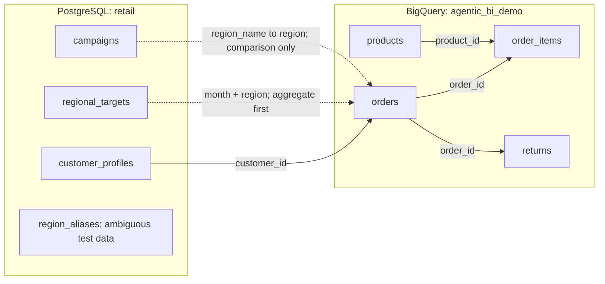

# Retail database schema guide

This page documents the **original demo profile**. The larger, separately stored dataset is described in [expanded retail history](retail-timeseries.md) and its [column/type dictionary](retail-timeseries-schema.md). Both versions can coexist; uploading the new tables does not replace these original ones.

This describes the schema and deterministic seed defined by `Backend/app/fixtures.py`, the cloud table creation in `Backend/app/admin.py`, and the configured source names. Counts and examples were calculated from the seed on 16 October 2026; they are not a fresh inspection of hosted databases. All customers and transactions are synthetic. Dates cover January–September 2026; monetary values are USD.

## Where the data lives

| Source | Configured location | Purpose |
| --- | --- | --- |
| BigQuery | Project `project-e8b1593d-009a-4822-abf`, dataset `agentic_bi_demo`, location `asia-southeast1` | Sales transactions, products, and refunds |
| PostgreSQL | Cloud SQL instance `agentic-bi-demo-pg`, database `agentic_bi`, schema `retail` | Customers, business targets, campaign spending, and relationship test data |
| Firestore | Named database `agentic-bi-demo` | Application history, runs, skills, and result artifacts; separate from the analytical source tables below |

A BigQuery table can be addressed as `project-e8b1593d-009a-4822-abf.agentic_bi_demo.orders`. A PostgreSQL table is addressed as `retail.customer_profiles` after connecting to the `agentic_bi` database. In BigQuery, the namespace is a **dataset**; in PostgreSQL, `retail` is a **schema inside a database**.

The local fixture backend runs equivalent synthetic tables through DuckDB. Its schema inspector can therefore display Arrow types such as `string` or `decimal128`; the types below describe what the cloud seeding code creates.

## BigQuery tables

### `orders` — 720 rows

**Grain:** one row per completed order. There are 80 orders per month and nine orders per customer in the seed.

| Column | Type | Meaning / example |
| --- | --- | --- |
| `order_id` | STRING | Logical unique order identifier, e.g. `O01001` |
| `customer_id` | STRING | Customer reference, e.g. `C001`; relates to PostgreSQL profiles |
| `order_date` | DATE | Order date, e.g. `2026-01-02` |
| `month` | STRING | Reporting month in `YYYY-MM`, e.g. `2026-01` |
| `region` | STRING | `North`, `South`, `East`, or `West` |
| `revenue` | NUMERIC | Gross order revenue before refunds, e.g. `267.00` |
| `status` | STRING | All seeded values are exactly lowercase `completed` |

Use this table for total sales, trends, regional comparisons, and customer spending. `revenue` is an order total, not profit or revenue after refunds.

### `order_items` — 720 rows

**Grain:** one order line. The current simplified seed has exactly one line per order, with quantity potentially greater than one.

| Column | Type | Meaning / example |
| --- | --- | --- |
| `order_id` | STRING | Related order, e.g. `O01001` |
| `product_id` | STRING | Related product, e.g. `P003` |
| `quantity` | INTEGER / INT64 | Units on the line, e.g. `3` |
| `line_revenue` | NUMERIC | Revenue for that line, e.g. `267.00` |

Join `orders` for dates/regions and `products` for category analysis. In the seed, line revenue equals order revenue because each order has one line. If the demo later supports multiple lines, summing `orders.revenue` after a line join would repeat order totals; use `line_revenue` or aggregate lines first.

### `products` — 4 rows

**Grain:** one product, logically unique on `product_id`.

| Column | Type | Meaning / example |
| --- | --- | --- |
| `product_id` | STRING | Product identifier, e.g. `P001` |
| `product_name` | STRING | Product name, e.g. `Everyday tote` |
| `category` | STRING | Product category, e.g. `Accessories` |
| `unit_price` | NUMERIC | Current unit price, e.g. `48.00` |

The products are Everyday tote / Accessories / $48, Studio headphones / Electronics / $129, Trail sneaker / Footwear / $89, and Linen shirt / Apparel / $65. Use recorded `line_revenue` for historical sales; this schema has no price-history table.

### `returns` — 41 rows

**Grain:** one refund event. The seed has at most one return per order and refunds its full order amount.

| Column | Type | Meaning / example |
| --- | --- | --- |
| `return_id` | STRING | Logical unique return identifier, e.g. `RO01016` |
| `order_id` | STRING | Returned order, e.g. `O01016` |
| `refund_amount` | NUMERIC | Refunded amount in USD, e.g. `387.00` |
| `reason` | STRING | `Size or fit` or `Changed mind` |

There is no return-date column. A monthly refund analysis joined to `orders` groups by the original order month, not the date the refund was processed. State that distinction when interpreting the result.

## PostgreSQL tables

### `retail.customer_profiles` — 80 rows

**Grain:** one customer, logically unique on `customer_id`.

| Column | Type | Meaning / example |
| --- | --- | --- |
| `customer_id` | TEXT | Customer identifier, e.g. `C001` |
| `customer_name` | TEXT | Synthetic label, e.g. `Demo customer 001` |
| `region` | TEXT | Customer's assigned region |
| `segment` | TEXT | `Returning` or `New` |
| `loyalty_tier` | TEXT | `Gold` or `Standard` |

Use `customer_id` to combine customer attributes with BigQuery spending. Customer names are labels, not reliable join keys. Segment and loyalty are seeded attributes; they are not calculated from a customer's first-order date or loyalty history, neither of which is stored here.

### `retail.regional_targets` — 36 rows

**Grain:** one region in one month: 4 regions × 9 months. The logical key is **both `month` and `region`**.

| Column | Type | Meaning / example |
| --- | --- | --- |
| `month` | TEXT | Reporting month, e.g. `2026-01` |
| `region` | TEXT | Region, e.g. `North` |
| `target_revenue` | NUMERIC(18,2) | Monthly regional target, e.g. `3300.00` |

Aggregate BigQuery orders by `month, region`, then match targets at that same grain. For a nine-month regional summary, aggregate **both** sources by region before joining. Joining raw orders to targets on region alone repeats values across months and gives misleading totals.

### `retail.campaigns` — 4 rows

**Grain:** one campaign; the seed has one campaign per region.

| Column | Type | Meaning / example |
| --- | --- | --- |
| `campaign_id` | TEXT | Logical unique campaign identifier, e.g. `M001` |
| `region_name` | TEXT | Region label, e.g. `North` |
| `campaign_name` | TEXT | Campaign label, e.g. `Fresh start` |
| `spend` | NUMERIC(18,2) | Campaign spending, e.g. `750.00` |

`region_name` can be inferred to correspond to `orders.region`. This supports a regional sales-versus-spend comparison. There is no campaign date range, order attribution, or conversion link, so the schema does not establish campaign-generated revenue or causal marketing ROI.

### `retail.region_aliases` — 4 rows

**Grain:** a region-label/market mapping, deliberately not unique on region label.

| Column | Type | Meaning |
| --- | --- | --- |
| `region_label` | TEXT | `North`, `North`, `South`, or NULL |
| `market` | TEXT | Respectively `N1`, `N2`, `S1`, or `Unknown` |

This is adversarial test data for relationship inference. Joining North sales to both North mappings repeats those sales. It is not the canonical region dimension and must not be treated as a safe one-to-one relationship.

## How the tables relate



These are logical relationships, not declared database foreign keys. The seed code creates no primary-key, foreign-key, unique, or NOT NULL constraints. The identifiers/combinations described as unique are properties of the generated data. Cross-database joins are performed by the application's bounded fusion pipeline after separate source queries; a PostgreSQL query cannot directly name a BigQuery table through this connector.

## Queries to learn with

BigQuery: monthly gross revenue from the order table:

```sql
SELECT month, SUM(revenue) AS gross_revenue
FROM `project-e8b1593d-009a-4822-abf.agentic_bi_demo.orders`
WHERE status = 'completed'
GROUP BY month
ORDER BY month;
```

BigQuery: revenue by category using line-level amounts:

```sql
SELECT p.category, SUM(i.line_revenue) AS revenue
FROM `project-e8b1593d-009a-4822-abf.agentic_bi_demo.order_items` AS i
JOIN `project-e8b1593d-009a-4822-abf.agentic_bi_demo.products` AS p
  ON i.product_id = p.product_id
GROUP BY p.category
ORDER BY revenue DESC;
```

PostgreSQL: customer counts by segment:

```sql
SELECT segment, COUNT(*) AS customers
FROM retail.customer_profiles
GROUP BY segment
ORDER BY segment;
```

For cross-source learning, ask the app: “Compare monthly regional sales with targets,” or “Show gross revenue by customer loyalty tier.” The agent queries each source and combines compatible, complete results at the correct grain.

## Seed totals for checking your understanding

| Metric | Expected value across the full seed |
| --- | ---: |
| Orders | 720 |
| Customers | 80 |
| Returned orders | 41 |
| Gross revenue | $118,951.00 |
| Refunds | $8,256.00 |
| Net revenue: gross minus refunds | $110,695.00 |
| Regional revenue targets | $144,000.00 |

To calculate net revenue by region/month, aggregate refunds against their related orders at that same grain before subtraction. Do not subtract the full refund total separately from every region. The schema contains no product cost, margin, inventory, tax, shipping, or attribution fields; those analyses need additional data or an explicit definition.

For execution safeguards and fusion behavior, see [architecture](architecture.md) and [the fusion decision](adr/0003-bounded-cross-source-fusion.md). Administrative seeding can overwrite demo source data; learning the schema requires no reseeding. Follow [the deployment guide](deployment-guide.md) for actual cloud operations.
