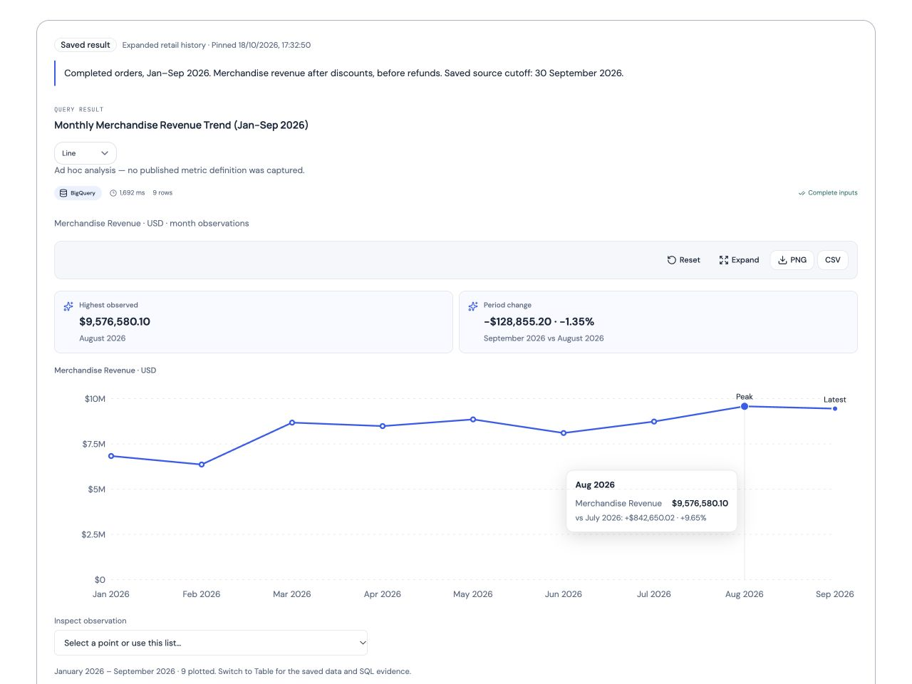
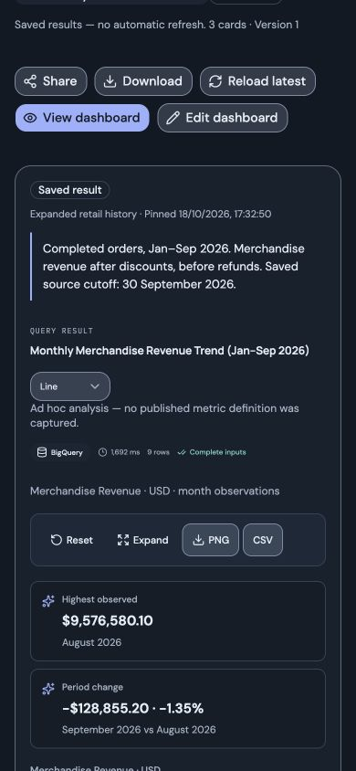

# Dashboard borders and spacing — Cloud Run release, 21 October 2026

**Outcome: deployed; requested border, spacing and responsive checks pass.** Each saved-result section has a clear theme-aware 1px outline, 18px rounded corners, 16–24px internal padding and a source-footer divider. The nested chat-result frame is flattened, retaining the 28px grid gaps and existing Standard/Wide behavior. A pre-existing expanded-chart focus-return limitation is recorded below; this is not full accessibility sign-off.

## Release

| Item | Verified value |
| --- | --- |
| Frontend serving revision | `agentic-bi-frontend-00048-qux`, 100% traffic |
| Previous / rollback revision | `agentic-bi-frontend-00045-gej` |
| API | `agentic-bi-backend-00024-rnd`, unchanged |
| Private worker | `agentic-bi-report-worker-00013-sm4`, unchanged |
| Cloud Build | `5731572f-8a70-4493-8840-3ccdbd22a2a1`, `SUCCESS` |
| Frontend image digest | `sha256:b4f5c1c5bf8a5d46e9c534f1fa0a8e0c0300adf1dbd651547211ca25c2848dcb` |
| Source base | `55c89fc98475ed2343693b62147072955aafd317`, with the reviewed working-tree styling change |

The runbook's image-only path used the dedicated builder and existing image repository. The new revision was deployed without traffic and verified for readiness, unchanged runtime specification/annotations and four candidate routes before promotion. Its temporary tag was removed. There were no environment, secret, IAM, identity or backend/worker changes. Submission materials in the actual `Submision/` folder remain excluded from Git and Cloud Build; the inspected upload contains neither submission-folder spelling nor root `.env`.

Only `Frontend/src/app/dashboards.css` changes application behavior. Chart rendering, controls, source/metric/forecast evidence, persistence, analytical execution and downloads remain on their existing paths. Browser outlines do not change the separate saved-view export renderer. No component boundary or execution flow changed; Graphify remains its separately dated snapshot.

## Engineering gates

All **58 frontend tests**, ESLint and TypeScript pass again. The preceding local production build passed, and Cloud Build independently completed the production image. No stylesheet-mirroring test was added for this reversible presentation change. Backend code did not change and backend/model suites were not repeated.

The actual upload archive matches **147 frontend/build-control source hashes**. Generated TypeScript incremental cache is recorded separately and is not treated as application source. Source validation and `git diff --check` pass.

## Hosted browser verification

The [Fusion Retail Leadership Demo](https://agentic-bi-frontend-wekihucn7q-as.a.run.app/dashboards/f3e02849a4873200a4a0e83347f4d13b) supplied saved wide and standard line/bar cards, notes, skills and evidence. No cards were edited or republished. Browser checks covered:

- Before-release sections had 0px borders and padding; deployed sections have 1px borders and footer rules.
- Desktop 1280px light/dark, tablet 768px and mobile 390px/320px layouts retain visible sections and no document horizontal overflow.
- Desktop padding is 24px; mobile padding is 16px. The wide card spans both desktop columns and all cards use one mobile column. Grid gaps remain 28px.
- Nested result frames have no duplicate shadow or outer margin; notes, charts and source footers remain within their section.
- Keyboard Enter opens the expanded chart; Escape closes it. Mobile Edit mode retains three action groups inside their outlined sections without horizontal overflow. No shared changes were submitted.
- The complete captured verification window contains 80 GET requests and no mutation or analytical-submission request. Browser error logs are empty.
- Nine public routes return HTTP 200 and nine health/configuration checks pass, including connected sources, the larger profile, Cloud Tasks report mode and enabled TimesFM. The inspected frontend verification-window logs contain zero severity-ERROR entries.

The browser record contains **13 passing assertions and one failed focus-return assertion**. All requested style/responsive assertions pass. Returning keyboard focus to the chart trigger does not pass: after Escape, the active element is BODY. A control using the previous `.next-release-check` frontend bundle, with 0px section outlines and a separate local fixture backend, reproduces the same behavior. This predates the border styling; no focus logic was changed. It remains a follow-up accessibility issue. An initial local control failed because of its fixture CORS origin; a separate correctly scoped fixture backend resolved that test-harness issue. Both observations are retained rather than presented as successful checks.

Screenshots use the deployed synthetic retail dashboard: [desktop](dashboard-borders-release-20261021-desktop.jpg) and [mobile](dashboard-borders-release-20261021-mobile.jpg).





## Preservation

All **19 preservation checks** pass. API/worker specs, latest revisions, traffic and all three service IAM policies match the before-release snapshot. Frontend runtime specification and CPU/allocation annotations are unchanged apart from the image. API and worker both retain:

```text
DATA_PROFILE=timeseries
SOURCE_ROW_LIMIT=30000
REPORT_TIMESFM_ENABLED=true
REPORT_TIMESFM_VERIFIED=true
```

Five BigQuery table metadata snapshots match exactly, including rows, bytes, schemas and modification timestamps: **573,348 orders; 1,317,941 line items; 97,122 returns; 200 products; 1,369 calendar days**. These metadata reads do not claim a new content fingerprint or analytical SQL scan. PostgreSQL was not recounted; its connected status and runtime configuration were verified. No analytical writes, upload, seeding, quota increase/reset or history reset occurred.

The leadership dashboard and [saved TimesFM dashboard](https://agentic-bi-frontend-wekihucn7q-as.a.run.app/dashboards/91ba0cccdd954464bd295558c008133c) have identical complete read-response hashes before/after, preserving their published revisions, items and views. The hosted browser tests executed no source queries, Gemini, report generation or TimesFM inference. Local focus-control tests used disposable memory/fixture services only.

## Limits and evidence

Viewports are emulated; physical devices, full screen-reader/contrast scans, other browsers, voice, fresh AI dashboard builds, forecasting and exports were not retested. The expanded-chart focus issue remains explicit. Browser theme/viewport overrides were restored and temporary testing tabs/services were closed. Original local preview services remain available separately.

- [Build-source hashes and exclusions](dashboard-borders-release-20261021-source.json)
- [Candidate readiness/configuration](dashboard-borders-release-20261021-candidate.json)
- [Hosted layout, interaction and request evidence](dashboard-borders-release-20261021-browser.json)
- [Health/configuration/routes](dashboard-borders-release-20261021-http.json)
- [Service, IAM and source-metadata preservation](dashboard-borders-release-20261021-preservation.json)
- [Unchanged saved dashboard snapshots](dashboard-borders-release-20261021-saved.json)

Publication includes the styling, feature guide, release metadata and dated verification evidence. No guest credentials, secret contents, raw audio or submission materials are included.
