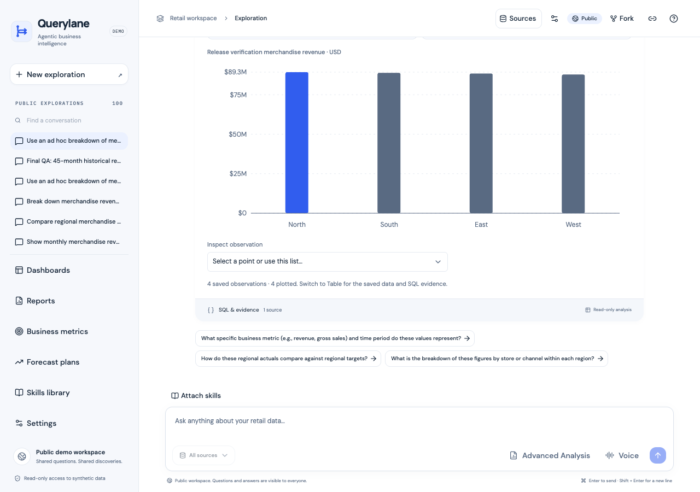
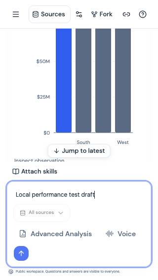
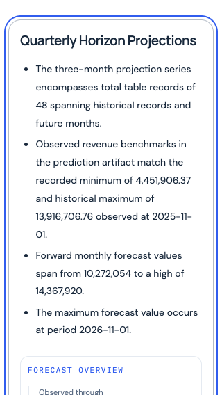

# Remaining loading delays — investigation and local fixes, 23 October 2026

This follows the [hosted loading-speed release](loading-speed-release-20261023.md) at `d672716`. The changes are locally verified and have not been deployed or pushed. Historical release records remain unchanged.

## Diagnosis and evidence

The original **4,517.8ms** visible-chart data response coincided with a similarly delayed report-list read. Available server request durations were much smaller, but the original capture lacked network phases and exact per-read correlation. It cannot establish packet loss, browser queueing, a cold start or a storage cause. Twenty new naturally warm saved-conversation traces did **not** reproduce that stall. The largest fresh request was a source-status check: 971.7ms, with about 802ms of BigQuery metadata work. Source checks remain independent from history/conversation text; their execution/readiness safeguards were not weakened.

Two actual frontend bottlenecks were reproduced:

1. **Speculative route traffic:** twenty off-route frontend fetches ran while the visible chart was pending. The minimized browser command was `python3 /tmp/querylane-delay-repro.py /tmp/querylane-delay-local-baseline.json http://localhost:3130`; it failed with 20 speculative startup fetches and no chart-script overlap.
2. **Serial chart loading and fallback:** chart code began only after metadata returned. Merely preloading the module removed the serial network leg but left roughly 300ms between metadata and the chart-ready mark. The dynamic fallback could suspend again on an already resolved module. Synchronously using the ready imported component removed that measured gap; the ordinary dynamic component remains the fallback when code is unavailable.

The same reproduction command on the final candidate passed with zero speculative startup fetches and two chart-script requests overlapping metadata. The code/data tasks stay separate: code failure cannot hide saved metadata or replay a read. The existing two-request saved-evidence limit, cancellation and off-screen admission remain.

## Implemented corrections

- Shared application `AppLink` preserves Next.js click navigation, hrefs, refs, labels and handlers with `prefetch={false}`. Application navigation and evidence links use it. Landing components keep their existing independent policy. This trades speculative next-page warming for current-page priority; it does not disable client navigation.
- Nearby workspace/report/dashboard cards start their split result-card module and saved metadata together. A stable prepared component is reused synchronously after import; direct/streamed cards keep the original dynamic fallback. No chart library is added to the initial static bundle and off-screen cards still avoid metadata requests.
- Bounded JSON reads disclose detailed resource timing only to configured frontend origins using `Timing-Allow-Origin`. A fresh sixteen-hex-character `X-Querylane-Read-Id` also appears in `Server-Timing` and safe read logs, so browser phases can be matched to application duration. Each 304 receives a new ID; IDs are not credentials or included in ETags. Unknown origins receive no timing permission. SSE, WebSockets and attachment bytes remain untouched. There is no telemetry collector or logging of questions/auth headers.

## Controlled production-build comparison

One warm-up plus ten observations per build, same browser viewport and copied saved conversation. The local fixture adds **400ms** to metadata reads to make ordering deterministic. No production cold start was forced.

| Measure | Baseline | Final candidate |
| --- | --- | --- |
| Speculative route requests before chart data | 20 | 0 |
| Chart scripts overlapping metadata | 0 | 2 |
| Data response median / p95 ms | 742.2 / 756.6 | 744.1 / 783.8 |
| Chart-ready mark median / p95 ms | 1061.2 / 1076.0 | 763.2 / 799.8 |

The data-response median remains effectively unchanged; the improvement is in chart code/render readiness. With localhost asset caches warm, preloading alone did not improve the median; that intermediate result is retained. The final synchronous reuse removes the unnecessary post-data fallback wait. These local measurements do not prove the historical 4.52-second incident is eliminated.

Twenty current hosted traces had chart-ready marks ranging 988.2–1166.3ms. HAR request phases show HTTP/3 with minimal blocked/receive time in this fresh sample; most request time was wait time. Detailed `PerformanceResourceTiming` fields were hidden for the API before the origin-scoped header change. The final local browser exposes request/response phases, application spans and the read ID. No raw HAR, request credentials or microphone/audio recordings are published.

## Verification and preservation

- **456 backend tests passed, one existing skip; 88 frontend tests passed.** Ruff, ESLint, TypeScript and final production build pass. Regression tests cover normal link props, parallel module/metadata loading, failed warm-up recovery, synchronous prepared-component reuse, approved/foreign timing origins and unique IDs on 304 responses.
- Desktop 1280px and mobile 390px/320px layouts fit. Draft retention, source-sheet focus restoration, mobile report section navigation/cutoff and saved dashboard rendering pass. A mobile Reports link completes real client navigation on click. The landing page makes zero API requests, and the clean final browser session has no page errors.
- All six copied forecast/scenario PDF, Word and data downloads retain original bytes/checksums. No report version or analytical evidence was regenerated.
- 21 before/after live comparisons preserve runtime specs, revisions/traffic, identities/IAM, warm service minima and five-table metadata. Frontend/API minima remain one and worker remains zero. API/worker retain `DATA_PROFILE=timeseries`, `SOURCE_ROW_LIMIT=30000` and both verified/enabled TimesFM flags. The dataset retains 573,348 orders, 1,317,941 line items, 97,122 returns, 200 products and 1,369 calendar days; 25,000 PostgreSQL profiles were not recounted. Both Submission spellings remain excluded from Git/build uploads.

## Limits and references

- The historical 4.52-second request has no HAR phases or per-read correlation ID. Its exact cause cannot be reconstructed; twenty new warm hosted traces did not reproduce it.
- The controlled fixture deliberately adds 400ms to saved metadata. Local browser results isolate code-loading/rendering behavior and are not deployed performance claims.
- Application links now fetch on click, preserving client navigation but giving up speculative next-page warming.
- Desktop and 320px/390px emulation only; no physical mobile keyboard, microphone, full screen-reader, contrast or 200% zoom certification.
- No new analytical/model job, data upload, quota/history reset, deployment, GitHub publication or cloud configuration change.
- The first local dashboard fixture lacked the saved board and the first navigation assertion sampled before route completion. These were harness limits: the board was mirrored read-only into local memory and explicit URL/loaded-chart rechecks passed.

Context7 returned a monthly quota error; no training-data fallback was used. The installed Next.js 16.4.1 Link documentation confirms `prefetch={false}` disables viewport/hover prefetch. [React link documentation](https://react.dev/reference/react-dom/components/link) and [MDN timing-origin documentation](https://developer.mozilla.org/en-US/docs/Web/HTTP/Reference/Headers/Timing-Allow-Origin) were consulted. No speculative preconnect or global caching change was added.

[Machine-readable evidence](loading-contention-local-20261023.json).

