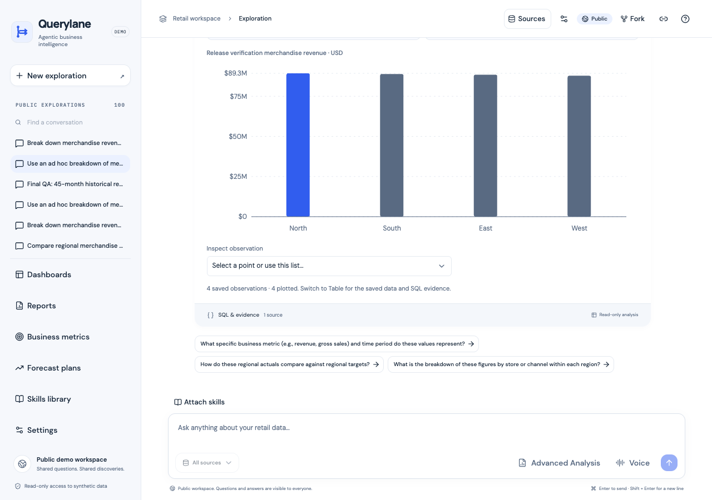
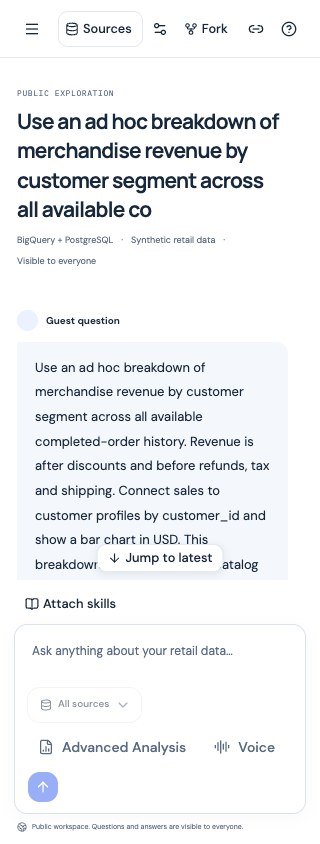
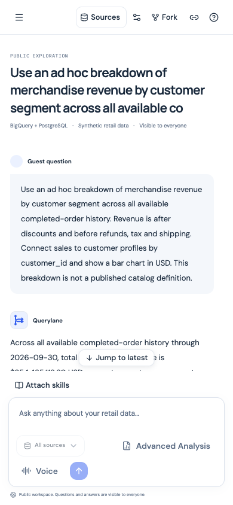
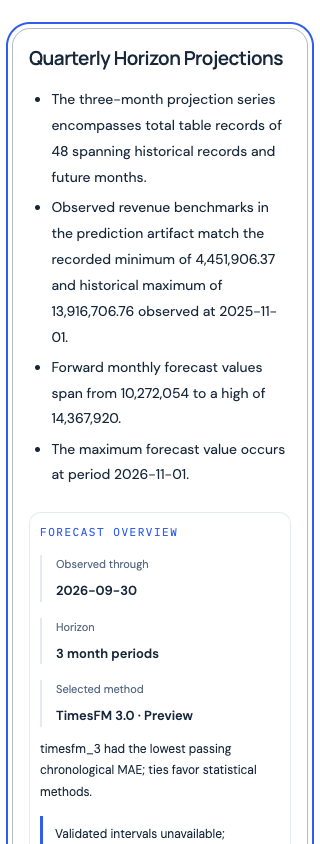

# Loading-contention fixes — hosted release, 23 October 2026

Verified 2026-10-23T05:21:52.733300+00:00. This follows [the local investigation](loading-contention-local-20261023.md), preserving its historical observations.

## Release and preservation

| Service | Previous revision | Serving revision | Service minimum |
| --- | --- | --- | --- |
| frontend | `agentic-bi-frontend-00026-g5t` | `agentic-bi-frontend-00027-26h` | 1 |
| backend | `agentic-bi-backend-00027-cgw` | `agentic-bi-backend-00028-4rq` | 1 |
| report-worker | `agentic-bi-report-worker-00016-477` | `agentic-bi-report-worker-00017-ghr` | 0 |

Each exact ready revision serves 100%. Private worker → API → frontend rollout used image-only updates, with no-traffic candidate verification before promotion. Twenty-four comparisons pass for runtime/secret references, identities, IAM, CPU/billing/boost annotations, concurrency, ceilings, flags and source metadata. Frontend/API minima remain one; worker minimum remains zero. No deployment helper reset, keepalive, seeding, upload, quota/history reset or IAM change occurred.

The larger synthetic source retains **573,348 orders, 1,317,941 line items, 97,122 returns, 200 products and 1,369 calendar days**. API/worker retain `DATA_PROFILE=timeseries`, `SOURCE_ROW_LIMIT=30000`, `REPORT_TIMESFM_ENABLED=true` and `REPORT_TIMESFM_VERIFIED=true`. [Preservation evidence](loading-contention-release-20261023-preservation.json) contains exact hashes/comparisons. [Source evidence](loading-contention-release-20261023-source.json) binds successful builds and immutable image digests to 228 runtime/build hashes and both upload archives; neither Submission folder was uploaded.

## Verified behavior

- All **29 hosted HTTP checks pass**: health/readiness, source status, gzip/ETag/304/CORS, exact optional saved-chart preview, missing artifact 404, six unchanged attachments, HTML bootstrap, private-worker denial and saved completed-run SSE replay. No model/job mutation was invoked.
- Exact configured frontend origin receives browser timing permission; a foreign origin does not. A fresh safe read ID is present on each eligible response, including 304, matches Server-Timing and correlates to the new API revision application log. Browser cross-origin request phases and Server-Timing are readable. SSE/download handling remains unchanged.
- Desktop 1280×900 and mobile 390px/320px have no document overflow. Header/composer remain anchored when conversation position changes. Source/navigation sheets restore keyboard focus and retain the exact unsent draft; closing does not leave scroll locked. A mobile Reports click reaches `/reports`.
- The immutable forecast reader at 320px starts with zero artifact/chart requests; selecting Quarterly Horizon Projections loads the nearby saved chart, focuses the section and retains the 30 September cutoff. The saved prediction dashboard renders at 390px without horizontal overflow. Landing navigation starts zero API reads. The isolated browser session records no page errors and was closed.
- Six forecast-v3/scenario-v2 PDF/Word/ZIP downloads match all pre-release bytes/checksums. They were not regenerated. Local suites passed **456 backend tests (one existing skip), 88 frontend tests**, Ruff, ESLint, TypeScript and production build; six backend and seven frontend targeted regressions passed again during release.

## Warm comparison

Same saved conversation and 1280×900 Chromium session, one recorded warm-up followed by ten samples per phase. No forced cold starts. Chart-ready is an application effect mark, not first paint.

| Measure | Before median / p95 | After median / p95 |
| --- | --- | --- |
| Saved chart metadata response (ms) | 821.65 / 951.30 | 857.85 / 1005.20 |
| Chart-ready mark (ms) | 1139.05 / 1267.40 | 865.65 / 1013.60 |
| Wait after metadata response (ms) | 314.35 / 319.80 | 7.85 / 8.40 |
| Speculative app-route requests | 20.00 / 20.00 | 0.00 / 0.00 |
| Initial API reads | 6.00 / 6.00 | 6.00 / 6.00 |

The observed post-data wait falls from about 314ms to 8ms; speculative route traffic falls from twenty to zero. Median chart-ready improves approximately 24%, despite slightly slower metadata delivery in this sample. Existing six API reads remain; this release changes scheduling/rendering, not storage or analytical query speed. Explicit clicks still navigate normally. The earlier 4.52s outlier is not reproduced and its exact cause remains unproven.

| HTTP endpoint | Before median / p95 ms | After median / p95 ms |
| --- | --- | --- |
| frontend_html | 384.51 / 772.83 | 359.43 / 454.60 |
| runtime_config | 258.64 / 523.26 | 268.30 / 344.31 |
| history | 354.14 / 823.05 | 434.81 / 495.22 |
| connections | 239.44 / 655.60 | 278.33 / 345.04 |
| conversation | 313.50 / 682.55 | 331.95 / 453.87 |
| report_config | 254.24 / 571.43 | 275.06 / 347.50 |

Endpoint medians vary in both directions. No universal transport/backend speedup is claimed. Fresh source execution, bounded evidence reads, immutable parameters and cancellation/retry behavior remain intact.

## Limits

- Emulated Chromium desktop/mobile widths; no physical device/keyboard, microphone, exhaustive screen-reader, contrast, cross-browser or 200% zoom certification repeated.
- Ten warm samples per phase are a small sequential observation, not a controlled network guarantee. Chart-ready is an application effect mark, not paint. Per-resource transport variation remains.
- The historical 4.52-second stall was not reproduced in this release sample or the preceding twenty-sample investigation; its exact historical cause is unproven. The observed speculative-traffic and post-data rendering delays are separately verified.
- Saved report/dashboard checks and six unchanged downloads do not establish fresh analytical, TimesFM, scenario or planning worker acceptance. No such new jobs ran.
- Dataset preservation compares five BigQuery tables by row/byte/schema/modification metadata, without content scans. Previously verified 25,000 PostgreSQL profiles were not recounted.

[All samples and machine-readable checks](loading-contention-release-20261023.json).

