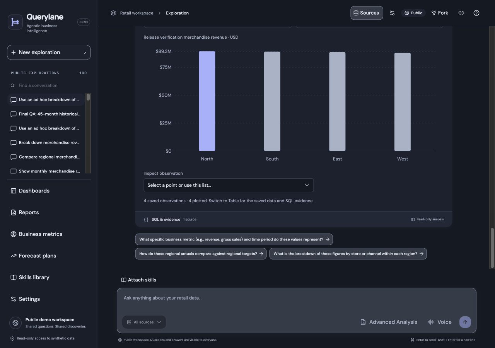
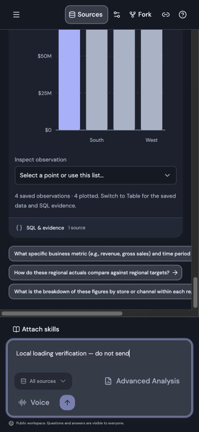
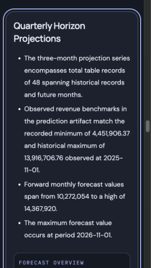

# Loading speed — local verification, 23 October 2026

This is implementation and local release preparation over `7db9c58fa7641b48094480f6c0fd4c3d46072828`. No Cloud Run deployment, GitHub publication, IAM/settings change, source upload, shared-history reset, model call or new analytical query was performed. Both Submission spellings remain excluded. [The hosted workspace release](workspace-loading-release-20261022.md) remains the latest deployment record.

## Implemented changes

- Application-only request-time layouts read the public `BACKEND_URL` and install it before descendant read effects. Backend data is still fetched in the browser; HTML never waits for API/source reads. `/api/config` remains a fallback. The landing page stays statically rendered and backend-free.
- Public history/selected-conversation reads use bounded, memory-only validators (eight bodies, at most 1 MiB total, 256 KiB/body). Every reuse requires a fresh HTTP 304; errors remain visible. Idle polling changes from eight to thirty seconds, with non-overlapping focus/visibility refresh. Active-run SSE behavior and mutation retries are unchanged. Validators save transfer/parse work; they do not bypass fresh Firestore reads. Slower idle polling reduces those reads.
- Successful UI source checks are reused in-process for fifteen seconds and share in-flight checks. Responses disclose the original `checked_at` and cached status. Failures are not cached. Readiness and actual analytical execution keep their fresh connection/import-readiness safeguards.
- Saved-chart view reuse is process-local, thirty seconds, at most 32 entries / 8 MiB; each cached value is at most 1 MiB. Keys bind saved metadata, presentation version and all view parameters. Every route checks live artifact existence first. Existing two-render-slot and two-client-request limits remain. Computation failures are not cached.
- An optional initial preview accompanies metadata for saved charts of at most 500 rows/two pages. It uses the existing full-selection presenter; only an exact match of view parameters is reused. Larger charts retain the separate complete-data path. No raw observations or exported precision are reduced.
- Report chart metadata/rendering starts near the reader viewport. The evidence section resolves remaining provenance through the bounded loader when approached; downloads remain independent of loaded placeholders.
- GET JSON responses up to 1 MiB use scoped gzip and `Server-Timing`; SSE, WebSockets, attachment downloads and large JSON remain unbuffered/unmodified. Timing spans cover total read, Firestore read sums and source checks. Browser Performance marks/measures and first-per-document milestone attributes provide local diagnostics, with no telemetry collector or question/credential logging.

## Verification

Backend **455 passed, one existing skip**; frontend **84 passed**. Ruff, ESLint, TypeScript and production build passed. `/` remains static; application entry routes become request-time rendered to preserve runtime environment configuration. On ten local warm HTTP samples, median full HTML response was **1.78ms before / 5.16ms after**, p95 **12.47 / 13.20ms**. This small HTML tradeoff removes the later configuration round trip; it is not evidence of deployed latency.

Desktop and 390px/320px workspace checks passed: anchored shell/composer, retained draft, source checked-at disclosure, Escape focus return and table/bar dropdown controls. Report narratives rendered before any chart requests; charts loaded on approach and section selection transferred focus. Both provenance timestamps remained available. Forecast cutoff and conditional-scenario caveats were retained. The local browser console had no errors and landing navigation produced zero API requests.

All six saved forecast/scenario PDF/Word/data downloads match the original bytes and checksums. These were existing immutable versions mirrored into local storage, not rerendered or regenerated. Streaming/chunk-preservation, changed/deleted resource handling, source-check singleflight/expiry, cache eviction/expiry, retry, cancellation and focus-revalidation regressions pass.

## Warm request measurements

Ten samples per frontend at 1280×900, same browser and fixture API. No production cold start was forced. Captured Chrome network timestamps exclude automation-tool wait time.

| Measure | Baseline frontend | Optimized frontend |
| --- | --- | --- |
| Initial API requests through first chart data | 8 | 6 |
| First visible-chart data response, median | 818.9ms | 469.5ms |
| First visible-chart data response, p95 | 1051.6ms | 544.6ms |
| Script requests before that response | 34 | 20 |

The candidate made no `/api/config` or separate initial `/chart-data` request in this saved conversation. This is data-response readiness, not measured first paint. Automatic route prefetches still exist; the different application rendering boundary fetched fewer script bundles in this trace. No blanket bundle-size or production speed claim is made.

The 100-item copied history response is **32,706 bytes uncompressed / 5,895 gzip**. Unchanged conditional reads return 304 with zero body bytes. At sustained idle, a thirty-second interval instead of eight means about 73% fewer scheduled polls per resource, excluding focus, manual refreshes and active work.

## Preservation and limits

The larger synthetic dataset, source-row/scan/fusion controls, TimesFM inference/gates, workload identities, warm frontend/API minima and worker scaling were not modified. Release-helper preservation tests still pass. The local fixture profile is isolated; it does not replace the hosted `timeseries` profile. Report versions, original exports and historical assessments remain intact. Real cloud performance and physical-device checks remain release gates; the [machine-readable evidence](loading-speed-local-20261023.json) contains sampling limits and retained observations.

