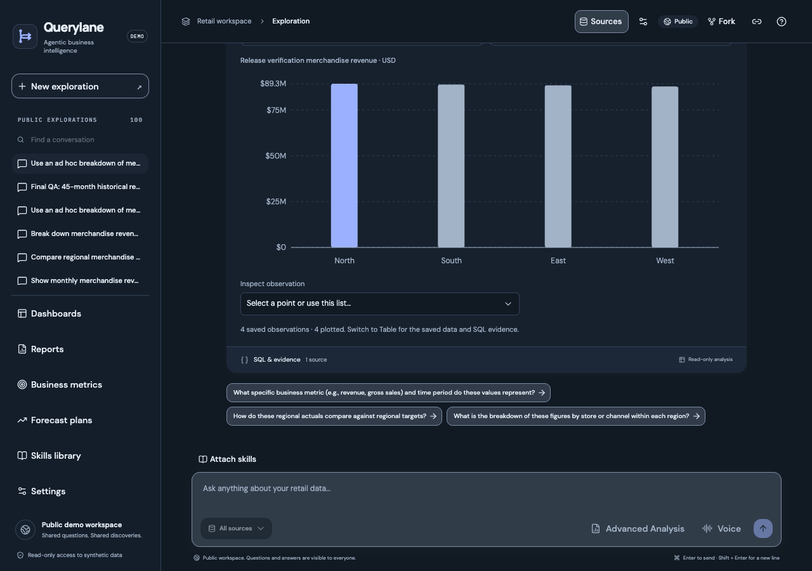
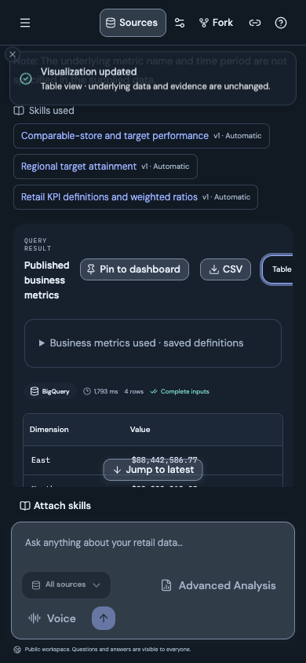
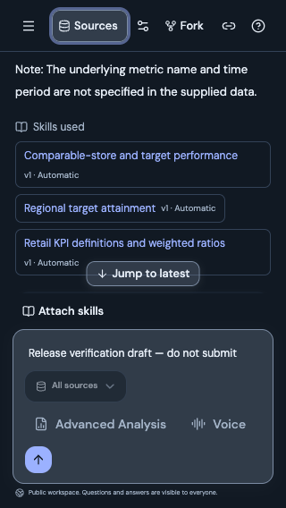
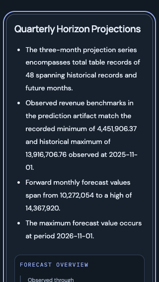

# Loading speed — Cloud Run release, 23 October 2026

Verified at 2026-10-22T19:59:07.590635+00:00. The client date is 23 October in Asia/Colombo; cloud rollout timestamps are 22 October UTC. This is an actual release following [local verification](loading-speed-local-20261023.md).

## Serving revisions

| Service | Previous | Serving | Service minimum |
| --- | --- | --- | --- |
| frontend | `agentic-bi-frontend-00025-5cz` | `agentic-bi-frontend-00026-g5t` | 1 |
| backend | `agentic-bi-backend-00026-9r5` | `agentic-bi-backend-00027-cgw` | 1 |
| report-worker | `agentic-bi-report-worker-00015-d4h` | `agentic-bi-report-worker-00016-477` | 0 |

All traffic is pinned to these exact ready revisions at 100%. The private worker was updated before API admission, then frontend. Image-only updates preserved existing runtime specifications, environment/secret references, identities, IAM, concurrency, billing/CPU-boost annotations and scaling ceilings. Frontend/API minima remain one; worker remains zero. No keepalive, source upload, seeding, quota/history reset or IAM change occurred. [Preservation evidence](loading-speed-release-20261023-preservation.json) contains 24 passing comparisons. [Build/source evidence](loading-speed-release-20261023-source.json) binds immutable images and uploaded archives to 225 runtime/build source hashes; both Submission folders and credentials were excluded.

## Verified behavior

- 23 hosted HTTP checks pass: live/readiness, source status, gzip/ETag/304 and conditional CORS, exact optional chart-preview equivalence, missing artifact 404, six immutable downloads, runtime URL in HTML, private worker denial and completed saved-run SSE replay. SSE remains uncompressed; first replay line arrived in 350.63ms. No new run was created.
- Desktop 1280×900 and mobile 390px/320px workspace layouts fit their viewports, with anchored header/composer and no document overflow. Unsent draft survives source-sheet interaction and resize; Escape restores source/navigation trigger focus and leaves scrolling unlocked. Table selection shows all four saved regional rows.
- At 320px the forecast narrative rendered with zero initial artifact/chart requests. Approaching its section loaded the chart, retained the 30 September 2026 cutoff and focused the section. Scenario charts and conditional/noncausal caveats remain readable at 390px. Evidence metadata completed independently. The saved prediction dashboard renders without horizontal overflow.
- Landing navigation generated zero API requests. The isolated browser session recorded no page errors and was closed after checks. No physical microphone or saved preference mutation was used.
- All six forecast v3/scenario v2 PDF, Word and ZIP files are byte-for-byte identical to their pre-release downloads and remain uncompressed attachments. This release does not regenerate report files or establish new worker inference acceptance.
- Full local suites on the exact runtime source passed **455 backend tests (one existing skip)** and **84 frontend tests**, Ruff, ESLint and TypeScript. Five targeted backend tests passed again during release. Both Cloud production builds succeeded.

## Warm timing comparison

Ten warm samples follow one captured warm-up for each phase, same saved conversation and browser viewport. No cold start was forced. Measurements retain all samples and outliers.

| Browser measure | Before | After |
| --- | --- | --- |
| Initial API requests through first chart data | 8 | 6 |
| First visible-chart data response, median / p95 ms | 1450.6 / 1646.5 | 913.4 / 4517.8 |

The new workspace omits `/api/config` and the separate initial `/chart-data` request; `/api/v1/reports/config` remains. Median chart-data response improved, while one 4.52-second sample worsened browser p95. The report-list and artifact requests each took about 3.34 seconds in that browser sample. Captured API request logs show a maximum server latency of 0.599 seconds across 148 observations; this suggests transport/browser scheduling contributes, but no exact distributed trace proves the cause. The outlier is retained and no universal latency improvement is claimed. Chart-data response timing is not paint timing.

| Public HTTP endpoint | Before median / p95 ms | After median / p95 ms |
| --- | --- | --- |
| frontend_html | 751.5 / 1706.9 | 536.2 / 580.5 |
| runtime_config | 505.4 / 1122.3 | 361.9 / 439.7 |
| history | 708.2 / 1503.5 | 513.8 / 558.4 |
| connections | 1254.2 / 1526.4 | 337.5 / 405.4 |
| conversation | 585.0 / 1328.2 | 383.1 / 430.6 |
| report_config | 519.2 / 1312.0 | 363.0 / 400.1 |

The 100-item history response is **32,706 JSON bytes / 5,755 gzip bytes**. Unchanged conditional reads return 304 with zero body; each still reads current storage. Thirty-second idle polling reduces scheduled reads versus the previous eight-second interval; focus and active work remain immediate. Successful UI source status may reuse its disclosed fifteen-second snapshot; execution/readiness checks stay fresh.

## Preservation and limits

The five BigQuery tables retain exact metadata: **573,348 orders, 1,317,941 line items, 97,122 returns, 200 products and 1,369 calendar days**. The previously verified 25,000 PostgreSQL profiles were not recounted. API and worker retain `DATA_PROFILE=timeseries`, `SOURCE_ROW_LIMIT=30000`, `REPORT_TIMESFM_ENABLED=true` and `REPORT_TIMESFM_VERIFIED=true`. Warm minima, worker scaling, analytical safeguards and existing evidence are preserved.

- Emulated desktop/mobile widths; no physical keyboard, microphone, complete screen-reader, contrast or 200% zoom certification.
- Ten warm samples are a small observational comparison; chart-data response is not first paint or a guaranteed speedup. One retained candidate chart-data outlier increases browser p95 from 1.65s to 4.52s despite a lower median.
- Report/chart tests reused immutable saved evidence; no fresh analytical/model, TimesFM, scenario, dashboard-builder or forecast-plan worker execution.
- Five BigQuery tables were compared by row/byte/schema/modification metadata; no content scans or PostgreSQL customer recount.
- An initial scenario chart wait used a scroll offset before the actual chart; explicit section/placeholder navigation passed. Dropdown checks required waiting for transition completion; stale snapshot references were not counted as product failures.

[Machine-readable checks and timing samples](loading-speed-release-20261023.json).

