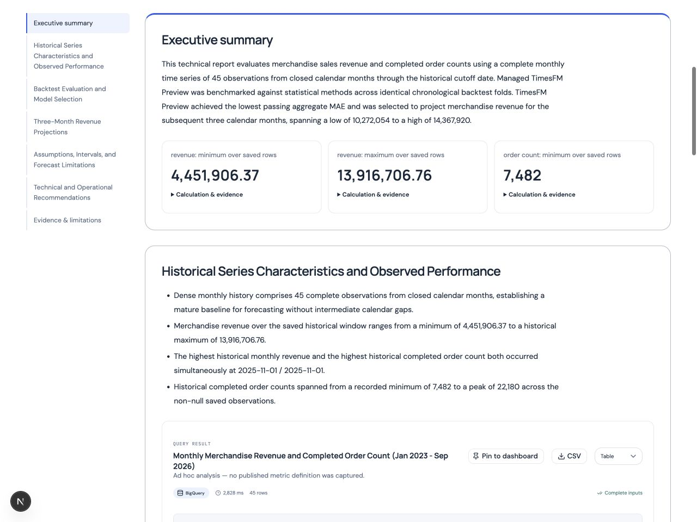

# Report presentation redesign — local verification, 21 October 2026

**Outcome: implemented and verified locally. Not a Cloud Run release or GitHub publication.** The Reports library, reader and newly rendered PDF/Word/data bundles share the briefing design. Existing hosted report versions and files were not rewritten.

## Implemented experience

- Bordered narrative sections and chart containers, consistent spacing, semantic bullet lists, a prominent executive summary and up to three saved numerical highlights.
- Document titles in the reader; editable library names remain separately visible with their source conversation. Metadata distinguishes saved version, creation date, source profile and evidence count.
- Active desktop section navigation and a mobile section selector that moves keyboard focus to its target. Library counts, friendly statuses and name/date sorting use saved metadata only.
- Forecast overviews retain cutoff, horizon, selected method, Preview and interval limitations. Candidate tables use recorded MAE/RMSE; baseline/alternative scenario assumptions have separate summaries and a full driver-path table. Full technical reproducibility remains inspectable.
- A4 PDF/Word briefings with numbered sections, contents for longer reports, chart captions, repeated table headers, formatted numbers and structured technical diagnostics. A separate complete-horizon point table prevents historical previews from hiding predictions. PDF uses embedded locally packaged fonts/bookmarks; Word retains editable heading/list/table styles, internal links and page fields.
- Data ZIP keeps artifact-ID CSV names, complete rows, original precision, predictions, SQL provenance and checksums. README, column/unit dictionary, saved document JSON and dataset titles are additive. Missing currency is not guessed. Existing single-result CSV behavior is unchanged.

## Verification

All **446 backend tests pass**, with one existing skip; Ruff passes. All **61 frontend tests**, ESLint, TypeScript and the production build pass. The production build used a separate ignored output directory; temporary generated TypeScript configuration changes were removed. The initial sandbox build stalled; a normal-permission isolated build completed successfully.

New tests cover both report styles, immutable inputs, repeatable outputs, genuine scenario zero paths, escaped visitor text, Word heading/link/page structures, column metadata compatibility, full-precision CSV/checksum consistency and honest allocated/adjusted labels. Existing report tests retain exact original downloads after revisions; TimesFM download tests prohibit inference.

Two public completed reports were copied read-only into an isolated local memory preview:

- Monthly forecast: report `9ef66a621f51ebe08d597f8380fecb18`, source version 1, 45 months of captured observations.
- Daily conditional scenario: report `e4112a63cba9d6886594cb89988ac4c5`, source version 1, 1,369 days of captured observations with the recorded fourteen-day hypothetical driver paths.

The saved numerical evidence and report text were reused for layout QA; no new forecast, scenario, writer or source execution was requested. The local copies are test fixtures, not new hosted report versions. All six local PDF/Word/ZIP download responses match their rendered files. Independent extraction verifies every future point in both PDF and Word: three monthly values and 42 daily values across the ordinary forecast and scenario baseline/alternative. Bundle row counts, CSV checksums, original prediction metadata, provenance and document JSON match the captured inputs. The original downloaded PDF copy still matches its captured checksum.

PDFs render to **10 and 17 pages**; Word renders to **9 and 15 pages**. Page contact sheets and representative full-size pages were inspected for headings, table continuation, chart labels and clipping. A blank Word contents page found during iteration was removed. Word and PDF use different pagination engines and need not have equal page counts.

Browser checks covered 1280px desktop and 390px/320px mobile widths, light/dark styling, section borders/padding, active outline, mobile focus transfer, comparison-table scrolling, scenario assumptions, independent source timestamps, library search/empty state/sorting/status filtering and a real PDF download. No document horizontal overflow was found at the tested widths. The inspected reader error log is empty. Viewport/media overrides were restored. A local report preview remains available on port 3015 with its isolated memory backend on 8015.

## Preservation and limits

No Cloud Run service, IAM, secret, quota, shared history, dataset, source profile or TimesFM setting was changed. No analytical data was uploaded or seeded. Submission materials were not edited. Published report files remain immutable; new export design takes effect on newly published versions, including explicit presentation revisions using saved evidence.

No execution stage, analytical endpoint, persistence boundary or architecture diagram changed. Graphify remains its separately dated source/document snapshot; this presentation verification is not a graph rebuild or deployment claim.

Mobile checks are emulated, not physical-device tests. Basic keyboard checks and semantic tables are not a full screen-reader/contrast certification. PDFs contain selectable text and bookmarks but are not PDF/UA tagged. Microsoft Word itself was not available for visual QA; Word outputs were rendered through the packaged LibreOffice tool. These checks do not repeat hosted AI, voice or private-worker acceptance.

- [Machine-readable checks and source hashes](report-design-local-20261021.json)
- [Report presentation contract](../reports.md#report-presentation)
- [Desktop reader](report-design-local-20261021-desktop.jpg)
- [Mobile reader](report-design-local-20261021-mobile.jpg)
- [Reports library](report-design-local-20261021-library.jpg)

