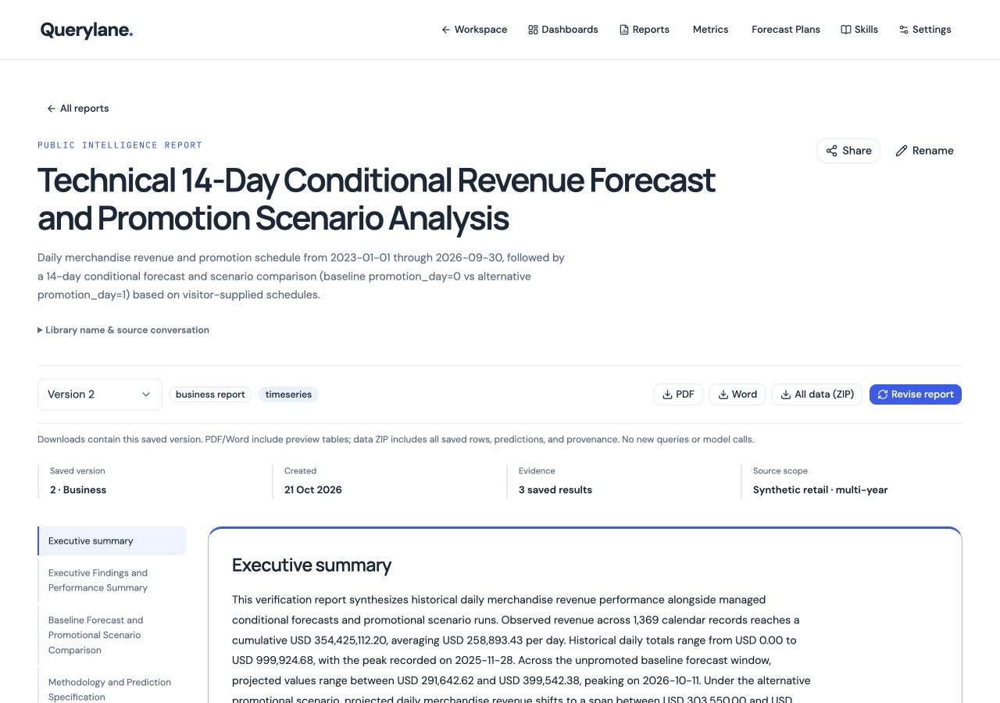

# Report briefing and shared dropdown release — 21 October 2026

**Deployed and verified.** The report library, reader and newly published downloads now use clearer section borders, spacing, saved-version metadata and structured forecast/scenario evidence. Thirty-six native selectors across nine component files now use a shared Radix dropdown adapter. Existing Radix controls in workspace, settings and Skills receive the same menu presentation fixes.

## Serving release

| Service | Previous revision | Serving revision |
| --- | --- | --- |
| Frontend | `00048-qux` | `agentic-bi-frontend-00023-hsg` |
| API | `00024-rnd` | `agentic-bi-backend-00025-8ml` |
| Private report worker | `00013-sm4` | `agentic-bi-report-worker-00014-kgl` |

Both regional Cloud Builds succeeded: backend `4fcce4aa-6141-4b5e-8c78-01a24655811c`, frontend `66f39771-c9e8-45a2-8857-371a4a28e894`. Backend digest is `sha256:ff98b8757359f0a00838e8ad30811bcf292e9919b0c445938e0ab27d465d2fa2`; frontend digest is `sha256:b0304a9a31461e4a434b1863789a138c77d6fb6588e85c116b75fc3314c9d6c0`.

The worker was staged, checked and promoted before the API and frontend. Every exact candidate was Ready with the expected digest and unchanged runtime specification/annotations. Each now serves 100% traffic. Service identities, resources, environment/secret references, concurrency/timeouts and IAM policies are unchanged. The worker remains private. Regional build lookup was used after an initial global lookup returned Not Found; no duplicate build was submitted.

The actual Cloud Build archives match **122 backend and 148 frontend application files**. Both archives contain 585 files and exclude `Submision/` and `Submission/`, dependencies and local secrets. Git also tracks neither Submission spelling. Temporary TypeScript include entries from the local production build were backed up and removed individually after automatic approval review rejected a wholesale restore. No unrelated configuration was discarded.

## Report and download acceptance

Two presentation-only versions completed through private Cloud Tasks worker execution:

- [Monthly forecast, version 3](https://agentic-bi-frontend-wekihucn7q-as.a.run.app/reports/9ef66a621f51ebe08d597f8380fecb18?version=3), run `207185d01e6c81c3bcb7a6b435aa6fc8`.
- [Daily conditional scenario, version 2](https://agentic-bi-frontend-wekihucn7q-as.a.run.app/reports/e4112a63cba9d6886594cb89988ac4c5?version=2), run `0da1eb895ed6aeb7f73479b5b1b0e807`.

Each captures exactly the artifact IDs from its original version. Actual persisted budgets show **zero source queries, scan bytes, numerical fits or fitting seconds**, and two model calls for writing/review per version. Two normal shared report admissions were consumed; the workspace counter is two. No quota was reset or raised. These are new presentations of verified saved predictions, **not fresh numerical forecasting acceptance**.

All six new PDF, Word and data ZIP downloads match their recorded checksums. The six corresponding original-version files still match their captured checksums. PDF/Word contain all three monthly and 42 daily future values, the 30 September 2026 cutoff and the saved method/conditional evidence. ZIP checks prove complete CSV row counts, checksums, exact prediction/provenance metadata and saved document JSON. README and dictionary are additive; original artifact CSV names/precision remain intact.

PDFs render to nine and fifteen pages; Word renders to eight and thirteen through LibreOffice. Every page was reviewed in contact sheets for structure, table continuation and clipping, with readable source tables, forecast values and scenario driver paths. PDFs retain bookmarks/selectable text; Word retains editable styles, contents links and page fields. Old files are immutable; the new design is generated only on publication of a new version.

Actual browser download controls worked for mobile PDF and ZIP and desktop Word. HTTP separately checked all formats for both reports. Opening readers, menus and downloaded files does not start new analysis.

## Dropdown audit and browser checks

The shared adapter preserves numeric versions/horizons, empty defaults, explicit labels, disabled states and existing JSON request values. Portaled popper menus use collision padding, a bounded scrolling viewport, wrapping long labels and theme colors. Action menus remain action menus; multi-select controls remain checkboxes. Hidden Radix form controls remain aria-hidden and untabbable.

The [machine evidence](report-dropdown-release-20261021.json) lists 18 browser check records and the 36-control inventory. Coverage includes:

- Reports status/sort/version controls, keyboard version selection, active desktop outline and mobile section focus transfer; local 49-option chart menu and live saved-chart observation selection.
- Forecast Plans numeric horizons and published metrics; Metrics archived filtering, with Ratio/empty-definition controls checked locally without publication.
- Dashboard library sorting, AI builder source/model/default controls, card width/precision dialog and pinning's 11-option dashboard menu. Test edits were canceled without saving.
- Existing Settings visualization and Skills source controls locally; the same shared primitive is used in workspace and voice author controls. No microphone or voice connection was started.
- 1280px desktop and 320px/390px narrow widths. A 320px report menu stays between x12 and x308; a 390px dialog menu stays between x32 and x358, and the scrolling pin menu between x12 and x378. Checked documents have no horizontal overflow.
- Dark system theme and reduced motion on the revision dialog; media/viewport overrides were restored. Menu Escape restores trigger focus after closing; section selection intentionally focuses its destination. Report scenario assumptions have a native caption and all fourteen future rows. Inspected report error logs are empty.

A few CDP Cancel calls timed out after their click; screenshots/DOM subsequently confirmed the dialogs closed and no save occurred. Initial animation-time focus observations were inconclusive; settled rechecks passed. A test initially searched for a nonexistent “Half” choice; the actual Standard/Wide choices were then tested. These tool observations were not treated as application failures or hidden.

## Tests and preservation

Backend: **446 passed, one existing skip**, Ruff passed. Frontend: **63 passed**, ESLint, TypeScript and production build passed. Live readiness/liveness and all eight main routes returned 200; legacy root chat links returned the expected fixed-origin 307 to `/app` with query preservation. `git diff --check`, JSON/link/graph checks and staged credential/Submission exclusion checks complete the publication gate.

API and worker retain `DATA_PROFILE=timeseries`, `SOURCE_ROW_LIMIT=30000`, `REPORT_TIMESFM_ENABLED=true`, `REPORT_TIMESFM_VERIFIED=true`. Five-table metadata is unchanged before/after: 573,348 orders, 1,317,941 line items, 97,122 returns, 200 products and 1,369 calendar days, with matching bytes, schemas and modification timestamps. No content rescan or PostgreSQL recount was performed; the existing 25,000-profile source remains untouched. No analytical upload/seed, migration, IAM/secret change, shared-history reset or data write occurred.

## Limits

Mobile sizes are emulated, not physical-device tests. Keyboard/semantic checks do not establish complete screen-reader or contrast compliance. PDF is not PDF/UA tagged; Word visual QA uses LibreOffice rather than Microsoft Word. The previously recorded expanded-chart BODY focus behavior remains outside this dropdown change. This release does not repeat voice, fresh numerical forecasting, AI Dashboard Builder or hierarchical Forecast Plans execution; consult their separately dated evidence and acceptance gates.

Graphify refreshes code and all changed-document semantics, with synchronized authoritative Mermaid copies and per-file hashes. It retains the partial workspace AST parse and unresolved/collapsed-edge limitations; graph edges are not runtime proof.

## Evidence

- [Machine results](report-dropdown-release-20261021.json)
- [Runtime/data preservation](report-dropdown-release-20261021-preservation.json)
- [Built-source hashes](report-dropdown-release-20261021-source.json)
- [Earlier local design assessment](report-design-local-20261021.md)
- [Desktop report](report-dropdown-release-20261021-desktop.jpg)
- [Mobile report](report-dropdown-release-20261021-mobile.jpg)
- [Mobile section menu](report-dropdown-release-20261021-mobile-dropdown.jpg)
- [Dark dialog menu](report-dropdown-release-20261021-dark-dialog.jpg)
- [Builder menu](report-dropdown-release-20261021-builder-mobile.jpg)
- [Scrolling pin menu](report-dropdown-release-20261021-pin-mobile.jpg)
- [Forecast PDF pages](report-dropdown-release-20261021-pdf-forecast.jpg), [scenario PDF pages](report-dropdown-release-20261021-pdf-scenario.jpg)
- [Forecast Word pages](report-dropdown-release-20261021-word-forecast.jpg), [scenario Word pages](report-dropdown-release-20261021-word-scenario.jpg)

