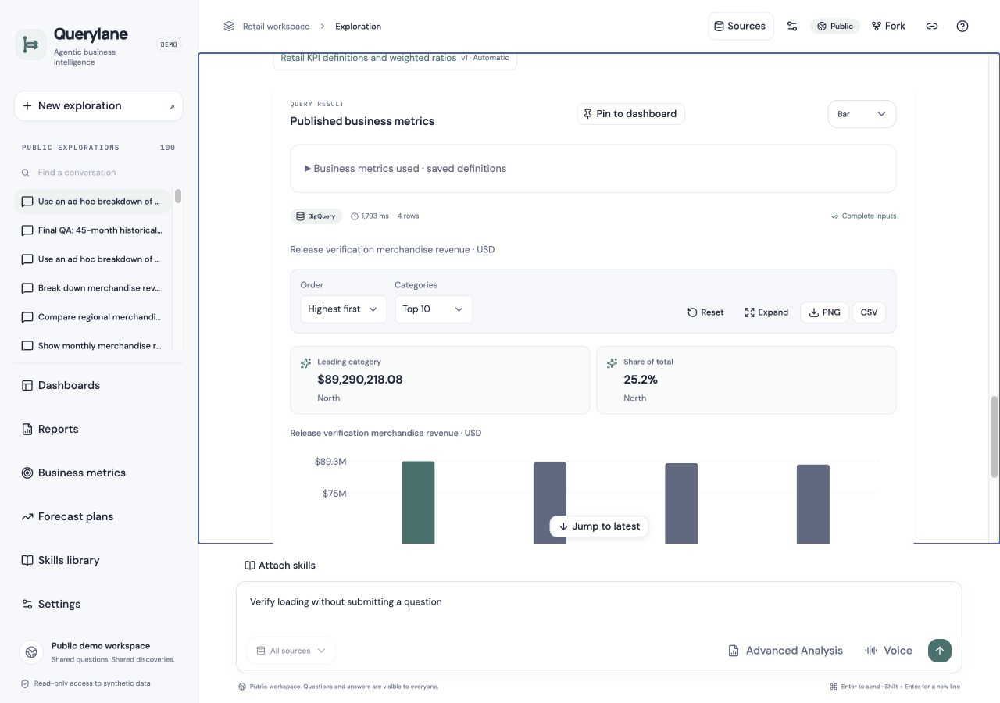
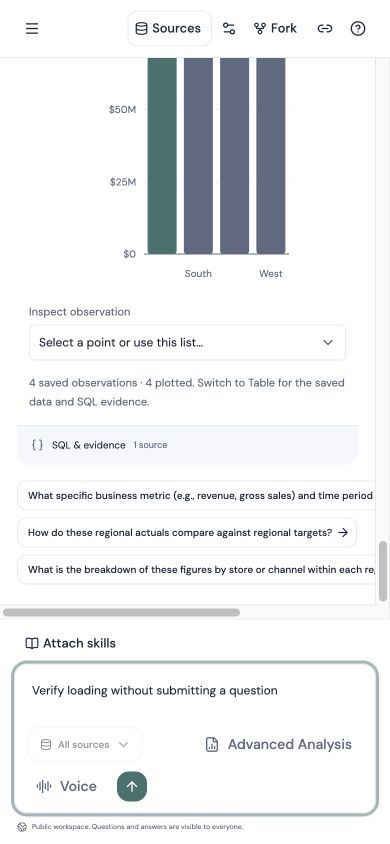
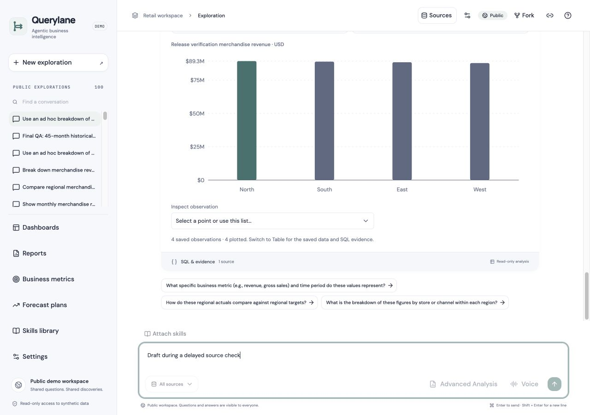

# Workspace and startup loading — hosted release, 22 October 2026 UTC

Verified at 2026-10-22T18:31:23.908616+00:00. The browser client crossed into 23 October in Asia/Colombo during verification. This is an actual release; earlier local assessments remain historical.

## Serving deployment

| Service | Previous | Serving | Service minimum |
| --- | --- | --- | --- |
| frontend | `agentic-bi-frontend-00023-hsg` | `agentic-bi-frontend-00025-5cz` | 1 |
| backend | `agentic-bi-backend-00025-8ml` | `agentic-bi-backend-00026-9r5` | 1 |
| report-worker | `agentic-bi-report-worker-00014-kgl` | `agentic-bi-report-worker-00015-d4h` | 0 |

All serving traffic is pinned to the verified named revisions at 100%. The private worker was deployed before API admission; anonymous worker access returns 403. API liveness/readiness and both analytical source connection checks pass. IAM, identities, resources, billing modes, startup CPU boost, concurrency and existing scaling ceilings were preserved. Only frontend/API service minima changed from zero to one. Worker minimum remains zero. No keepalive was added.

The final frontend build is `3c76082d-b4ef-47e1-9532-0a7e0fbf3b3d`; API/worker reuse backend build `832a5871-aca0-4711-82e3-150cff6f300a`. [Source verification](workspace-loading-release-20261022-source.json) links immutable image digests, uploaded archives and runtime hashes. Both Submission spellings, credentials, dependencies and local build outputs were excluded from build uploads.

## Behavior and verification

- The workspace document fits its viewport. Header/sidebar/composer remain anchored while conversation/history regions scroll; hidden chart instructions remain within positioned figures. Saved charts load near the visible conversation, through the existing shared two-request loader. Text appears independently.
- Desktop, 390px and 320px portrait, short/landscape 844px layouts, mobile navigation sheets, keyboard skip/jump/chart dropdown controls and delayed source recovery passed. The off-screen historical chart initially remains deferred and loads when approached; unchanged polls retain stable state.
- History and deep-linked conversation text remained available while source checks were deliberately held. After five seconds the slow-service message appeared; the draft survived timeout/recovery. Initial failures, retries, rate limits and stale-response behavior also have local/unit evidence.
- Reports, dashboard, Metrics, Forecast Plans and Skills libraries were checked at mobile width. An initial Skills header overflow (457px at 390px) was corrected with wrapping and rebuilt as frontend `00025-5cz`; final 390px/320px content fits and all navigation links remain reachable. The intermediate `00024-f8j` observation is retained in machine-readable evidence.
- Fresh frontend suite: **81 passed**, lint and TypeScript passed. Backend: **450 passed, one existing skip**; Ruff passed. Cloud production builds passed. A clean browser session recorded no console errors; the deliberately interrupted session retains expected injected transport errors.
- Landing navigation remains backend-free before application entry. No microphone or model call was made.

## Preservation and immutable downloads

All **24 preservation checks** pass: [sanitized configuration evidence](workspace-loading-release-20261022-preservation.json). Five BigQuery tables retain exact row/byte/schema/last-modified metadata: 573,348 orders, 1,317,941 line items, 97,122 returns, 200 products and 1,369 calendar days. The previously verified 25,000 PostgreSQL profiles were not recounted. No analytical data upload, source mutation, shared-history/quota reset or IAM/secret edit occurred. API and worker retain `DATA_PROFILE=timeseries`, `SOURCE_ROW_LIMIT=30000`, `REPORT_TIMESFM_ENABLED=true`, `REPORT_TIMESFM_VERIFIED=true`.

Forecast report [version 3](https://agentic-bi-frontend-wekihucn7q-as.a.run.app/reports/9ef66a621f51ebe08d597f8380fecb18?version=3) and scenario [version 2](https://agentic-bi-frontend-wekihucn7q-as.a.run.app/reports/e4112a63cba9d6886594cb89988ac4c5?version=2) each returned PDF, Word and data ZIP downloads. All six remain byte-for-byte identical before/after, match saved checksums and contain verified dataset checksums. This confirms saved-download preservation, not fresh worker inference. The saved [prediction dashboard](https://agentic-bi-frontend-wekihucn7q-as.a.run.app/dashboards/91ba0cccdd954464bd295558c008133c) remains readable.

## Warm timing observations

Eleven public HTTP rounds were captured per phase: one warm-up and ten warm samples, same client and saved conversation, parallel independent endpoints, nearest-rank p95. No cold start was forced. HTTP timings include the client network; they are not browser first-usable timings. Local browser waterfall/visible-chart measurements remain separately labeled in [local layout evidence](workspace-layout-local-20261022.md).

| Endpoint | Before median / p95 ms | Final median / p95 ms |
| --- | --- | --- |
| frontend_html | 547.0 / 851.7 | 610.9 / 2033.6 |
| runtime_config | 372.8 / 434.4 | 383.0 / 1217.4 |
| history | 545.1 / 806.0 | 571.2 / 1965.4 |
| connections | 972.9 / 1238.0 | 946.9 / 1848.6 |
| conversation | 408.2 / 507.2 | 433.8 / 1244.0 |
| report_config | 363.1 / 420.9 | 386.6 / 1203.8 |

The mixed timings and tail outliers do not establish a blanket raw-latency improvement. The intermediate connection p95 of 3,241ms and final outliers remain recorded. Independent reveal, deferred historical charts and the warm capacity policy reduce avoidable waiting/cold-start exposure; deployment/replacement/scale-out delays remain possible. See the [warm-service cost illustration](../deployment-guide.md#warm-service-operating-cost-illustration-22-october-2026): approximately $82.04/30 days of illustrative idle allocation before discounts and additional usage, not an actual bill.

## Limits and retained observations

- Emulated mobile widths; no physical mobile keyboard or complete screen-reader/contrast/200% zoom certification.
- Live theme preference changes skipped after automatic approval review rejected an un-restored theme test; existing local theme checks retained.
- A controlled source delay verified independent history/deep-link loading, slow feedback, retained draft and timeout recovery. Hosted HTTP503 injection failed in the harness; unit/local recovery coverage is separate.
- Warm HTTP latency is mixed, including retained intermediate and final tail outliers; this release does not establish a general network speedup.
- BigQuery metadata preservation verified for five tables; no source content scan or PostgreSQL customer recount.
- No fresh TimesFM, scenario, dashboard-builder or forecast-plan worker execution during this UI/startup release.
- An initial harness probe used `/health` (404); documented `/health/live` and `/health/ready` returned 200.
- The attempted hosted 503 fulfillment had an expired interception identifier; it is not counted as a hosted recovery pass. The interception was cleared and ordinary reads recovered.
- Prior report/dropdown and final analytical assessments are unchanged; fresh planning-worker acceptance remains separate.

## Screenshots

[Machine-readable results](workspace-loading-release-20261022.json) retain initial observations and final rechecks.
