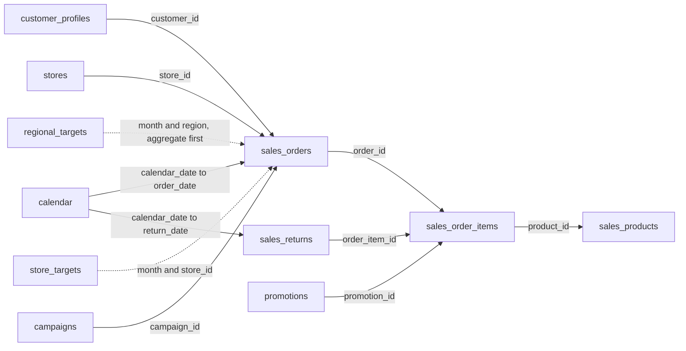

# Expanded retail column dictionary

Version `retail-timeseries-v1`. See [generation and upload](retail-timeseries.md) for date coverage, counts, and commands. This is additional to the original demo schema.

## `agentic_bi_demo.sales_products`

Product dimension: one product. unit_price is catalogue price; use sales_order_items.unit_price for historical prices. Categories, brands, and unit_cost enable product mix and merchandise margin, not full business profit.

Logical key: `product_id`. BigQuery uniqueness is enforced by validation and the fenced uploader, not a database primary key.

| Column | Cloud type | Nullable |
| --- | --- | --- |
| `product_id` | STRING | No |
| `product_name` | STRING | No |
| `category` | STRING | No |
| `brand` | STRING | No |
| `unit_price` | NUMERIC | No |
| `unit_cost` | NUMERIC | No |
| `launched_on` | DATE | No |
| `record_hash` | STRING | No |

`record_hash` is SHA-256 ingestion metadata, hidden from the agent’s schema view; it is not a business metric.

## `agentic_bi_demo.calendar`

Dense daily date spine, including zero-sales dates. Join calendar_date to order_date; LEFT JOIN daily aggregates and COALESCE missing sales to zero. week_start is Monday, ISO week/year are paired, fiscal year begins January. is_promotion_day marks the synthetic promotion calendar, not national holidays.

Logical key: `calendar_date`. BigQuery uniqueness is enforced by validation and the fenced uploader, not a database primary key.

Partition: `calendar_date`. Clustering: none.

| Column | Cloud type | Nullable |
| --- | --- | --- |
| `calendar_date` | DATE | No |
| `year` | INT64 | No |
| `quarter` | INT64 | No |
| `month` | STRING | No |
| `month_start` | DATE | No |
| `week_start` | DATE | No |
| `iso_year` | INT64 | No |
| `iso_week` | INT64 | No |
| `day_of_week` | INT64 | No |
| `is_weekend` | BOOL | No |
| `is_promotion_day` | BOOL | No |
| `record_hash` | STRING | No |

`record_hash` is SHA-256 ingestion metadata, hidden from the agent’s schema view; it is not a business metric.

## `agentic_bi_demo.sales_orders`

One completed order; status is exactly lowercase 'completed'. Multi-year daily synthetic history with weekly/annual seasonality, growth, promotions and named anomalies. order_timestamp is UTC; order_date/month are Singapore business dates. revenue is merchandise sales AFTER discounts, BEFORE refunds/tax/shipping. gross_sales is before discounts; total_paid includes tax/shipping. region is transaction/store region, not necessarily the customer's home region. All currency USD. Never sum order revenue after a many-line item join without re-aggregation.

Logical key: `order_id`. BigQuery uniqueness is enforced by validation and the fenced uploader, not a database primary key.

Partition: `order_date`. Clustering: `region`, `store_id`, `customer_id`.

| Column | Cloud type | Nullable |
| --- | --- | --- |
| `order_id` | STRING | No |
| `customer_id` | STRING | No |
| `store_id` | STRING | No |
| `order_timestamp` | TIMESTAMP | No |
| `order_date` | DATE | No |
| `month` | STRING | No |
| `region` | STRING | No |
| `channel` | STRING | No |
| `currency` | STRING | No |
| `gross_sales` | NUMERIC | No |
| `discount_amount` | NUMERIC | No |
| `revenue` | NUMERIC | No |
| `tax_amount` | NUMERIC | No |
| `shipping_amount` | NUMERIC | No |
| `total_paid` | NUMERIC | No |
| `units` | INT64 | No |
| `status` | STRING | No |
| `campaign_id` | STRING | Yes |
| `record_hash` | STRING | No |

`record_hash` is SHA-256 ingestion metadata, hidden from the agent’s schema view; it is not a business metric.

## `agentic_bi_demo.sales_order_items`

One line per order/product occurrence, with multiple lines per order. quantity, historical unit_price/unit_cost, gross_amount, allocated line discount, line_revenue and cost_amount. Sum line_revenue for category/channel product analysis; order_date duplicates the parent's business date for partition pruning. promotion_id may be null. Merchandise margin before returns = line_revenue-cost_amount; this is not accounting profit.

Logical key: `order_item_id`. BigQuery uniqueness is enforced by validation and the fenced uploader, not a database primary key.

Partition: `order_date`. Clustering: `product_id`, `order_id`.

| Column | Cloud type | Nullable |
| --- | --- | --- |
| `order_item_id` | STRING | No |
| `order_id` | STRING | No |
| `order_date` | DATE | No |
| `product_id` | STRING | No |
| `quantity` | INT64 | No |
| `unit_price` | NUMERIC | No |
| `unit_cost` | NUMERIC | No |
| `gross_amount` | NUMERIC | No |
| `discount_amount` | NUMERIC | No |
| `line_revenue` | NUMERIC | No |
| `cost_amount` | NUMERIC | No |
| `promotion_id` | STRING | Yes |
| `record_hash` | STRING | No |

`record_hash` is SHA-256 ingestion metadata, hidden from the agent’s schema view; it is not a business metric.

## `agentic_bi_demo.sales_returns`

One partial/full line refund. Links to order_item_id and order_id. return_date is the actual refund business date; order_date is original purchase date. refund_amount refunds discounted merchandise only, excluding tax/shipping. returned_cost reverses cost for returned units. Refund-date net revenue differs from order-cohort net revenue; clarify which is requested. Later generated snapshots add delayed returns without changing existing sales.

Logical key: `return_id`. BigQuery uniqueness is enforced by validation and the fenced uploader, not a database primary key.

Partition: `return_date`. Clustering: `order_id`, `product_id`.

| Column | Cloud type | Nullable |
| --- | --- | --- |
| `return_id` | STRING | No |
| `order_id` | STRING | No |
| `order_item_id` | STRING | No |
| `product_id` | STRING | No |
| `order_date` | DATE | No |
| `return_date` | DATE | No |
| `quantity` | INT64 | No |
| `refund_amount` | NUMERIC | No |
| `returned_cost` | NUMERIC | No |
| `reason` | STRING | No |
| `record_hash` | STRING | No |

`record_hash` is SHA-256 ingestion metadata, hidden from the agent’s schema view; it is not a business metric.

## `retail_timeseries.stores`

One fulfillment/retail store, with region, store_format and opened_on. Online orders also have a fulfillment store. Join store_id; never use region as a unique store key.

Logical key: `store_id`. PostgreSQL primary key is enforced.

| Column | Cloud type | Nullable |
| --- | --- | --- |
| `store_id` | TEXT | No |
| `store_name` | TEXT | No |
| `region` | TEXT | No |
| `store_format` | TEXT | No |
| `opened_on` | DATE | No |
| `record_hash` | TEXT | No |

`record_hash` is SHA-256 ingestion metadata, hidden from the agent’s schema view; it is not a business metric.

## `retail_timeseries.customer_profiles`

One synthetic customer, with signup_date, home region, acquisition_channel, segment and loyalty_tier. segment/tier are fixed synthetic attributes, not as-of historical snapshots. For cohorts use signup_date; calculate first observed purchase from actual orders if asked; this is not necessarily the lifetime first purchase. customer_id is the cross-source key; names are not keys.

Logical key: `customer_id`. PostgreSQL primary key is enforced.

| Column | Cloud type | Nullable |
| --- | --- | --- |
| `customer_id` | TEXT | No |
| `customer_name` | TEXT | No |
| `region` | TEXT | No |
| `segment` | TEXT | No |
| `loyalty_tier` | TEXT | No |
| `signup_date` | DATE | No |
| `acquisition_channel` | TEXT | No |
| `record_hash` | TEXT | No |

`record_hash` is SHA-256 ingestion metadata, hidden from the agent’s schema view; it is not a business metric.

## `retail_timeseries.regional_targets`

One full calendar-month target per region. Join sales aggregated at month AND region; targets for a partial final month remain full-month targets. Revenue target is after discounts and before refunds, tax and shipping.

Logical key: `month, region`. PostgreSQL primary key is enforced.

| Column | Cloud type | Nullable |
| --- | --- | --- |
| `month` | TEXT | No |
| `region` | TEXT | No |
| `target_revenue` | NUMERIC(18,2) | No |
| `record_hash` | TEXT | No |

`record_hash` is SHA-256 ingestion metadata, hidden from the agent’s schema view; it is not a business metric.

## `retail_timeseries.store_targets`

One full-month target per store. Sum store targets to reconcile regional_targets. Join sales at month AND store_id; partial-month actuals are not comparable to full-month targets without disclosure.

Logical key: `month, store_id`. PostgreSQL primary key is enforced.

| Column | Cloud type | Nullable |
| --- | --- | --- |
| `month` | TEXT | No |
| `store_id` | TEXT | No |
| `region` | TEXT | No |
| `target_revenue` | NUMERIC(18,2) | No |
| `record_hash` | TEXT | No |

`record_hash` is SHA-256 ingestion metadata, hidden from the agent’s schema view; it is not a business metric.

## `retail_timeseries.campaigns`

One monthly regional synthetic campaign with start/end dates and spend. Explicit campaign_id on orders represents last-touch synthetic association only, not proven incremental/causal marketing impact. Campaign spend is full-month even if generated order coverage ends mid-month.

Logical key: `campaign_id`. PostgreSQL primary key is enforced.

| Column | Cloud type | Nullable |
| --- | --- | --- |
| `campaign_id` | TEXT | No |
| `campaign_name` | TEXT | No |
| `region_name` | TEXT | No |
| `start_date` | DATE | No |
| `end_date` | DATE | No |
| `channel` | TEXT | No |
| `spend` | NUMERIC(18,2) | No |
| `record_hash` | TEXT | No |

`record_hash` is SHA-256 ingestion metadata, hidden from the agent’s schema view; it is not a business metric.

## `retail_timeseries.promotions`

One dated regional promotion. discount_percent is 0-100, not a fraction. Join order-item promotion_id to avoid range-join fan-out. Promotion calendars are synthetic and do not identify public holidays.

Logical key: `promotion_id`. PostgreSQL primary key is enforced.

| Column | Cloud type | Nullable |
| --- | --- | --- |
| `promotion_id` | TEXT | No |
| `campaign_id` | TEXT | No |
| `region` | TEXT | No |
| `start_date` | DATE | No |
| `end_date` | DATE | No |
| `discount_percent` | NUMERIC(18,2) | No |
| `promotion_name` | TEXT | No |
| `record_hash` | TEXT | No |

`record_hash` is SHA-256 ingestion metadata, hidden from the agent’s schema view; it is not a business metric.

## Relationships

Cross-database arrows are logical relationships resolved by controlled fusion or source SQL; they are not PostgreSQL foreign keys. PostgreSQL enforces store_targets→stores and promotions→campaigns. Historical artifacts retain the SQL and source timestamps used at the time.
